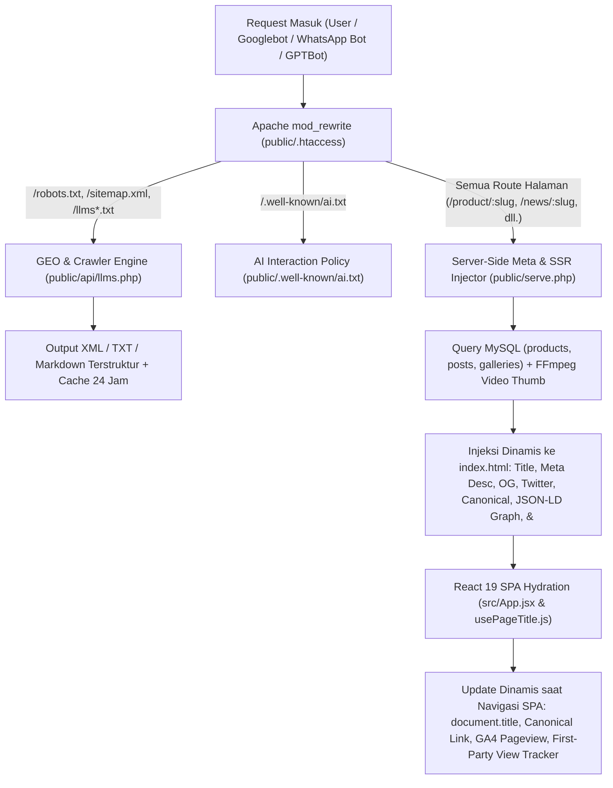
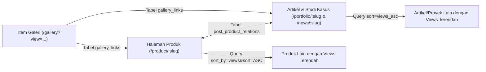

# Analisis Komprehensif & Mendalam Penerapan SEO, AEO, dan GEO pada Project ATEKA TEHNIK

Dokumen ini menyajikan audit dan analisis teknis secara menyeluruh (**end-to-end**) terhadap seluruh implementasi **Search Engine Optimization (SEO)**, **Answer Engine Optimization (AEO)**, dan **Generative Engine Optimization (GEO)** pada repositori **CV Ateka Tehnik** (`c:/xampp/htdocs/atekatehnik`).

Project ini menerapkan arsitektur **Hybrid SPA + PHP Edge/Server-Side Metadata & SSR Fallback Injection**, dipadukan dengan ekosistem **Dynamic GEO (`llms.txt` & `ai.txt`)**, **Structured Data (Schema.org JSON-LD)**, **AI-Driven SEO Content Generation**, serta **First-Party & Third-Party Analytics**.

---

## Daftar Isi

1. [Arsitektur SEO Secara Keseluruhan (Hybrid SPA + PHP Server Injection)](#1-arsitektur-seo-secara-keseluruhan-hybrid-spa--php-server-injection)
2. [Konfigurasi Server Apache, Routing Crawler, Caching & Kompresi (`.htaccess`)](#2-konfigurasi-server-apache-routing-crawler-caching--kompresi-htaccess)
3. [Server-Side Dynamic Meta, Open Graph, JSON-LD & SSR Fallback (`serve.php`)](#3-server-side-dynamic-meta-open-graph-json-ld--ssr-fallback-servephp)
4. [Generative Engine Optimization (GEO) & AI Discovery System (`llms.php` & `ai.txt`)](#4-generative-engine-optimization-geo--ai-discovery-system-llmsphp--aitxt)
5. [Dynamic `robots.txt` & `sitemap.xml` Berbasis Database](#5-dynamic-robotstxt--sitemapxml-berbasis-database)
6. [On-Page SEO Statis & Fallback Awal (`index.html`)](#6-on-page-seo-statis--fallback-awal-indexhtml)
7. [Client-Side Dynamic SEO Management (React SPA Layer)](#7-client-side-dynamic-seo-management-react-spa-layer)
8. [Structured Data / Schema.org (JSON-LD) Server-Side & Client-Side](#8-structured-data--schemaorg-json-ld-server-side--client-side)
9. [Pemetaan SEO Detail pada 16 Halaman Publik (`src/pages/`)](#9-pemetaan-seo-detail-pada-16-halaman-publik-srcpages)
10. [Strategi URL Semantik, Pembuatan Slug Otomatis & Deep-Linking](#10-strategi-url-semantik-pembuatan-slug-otomatis--deep-linking)
11. [Strategi Internal Linking, Content Siloing & Algoritma Distribusi Trafik (`views_asc`)](#11-strategi-internal-linking-content-siloing--algoritma-distribusi-trafik-views_asc)
12. [AI-Powered SEO Copywriting, Translasi Bilingual & Custom Markdown Parser](#12-ai-powered-seo-copywriting-translasi-bilingual--custom-markdown-parser)
13. [Local SEO, Brand Protection (Anti-Brand-Jacking) & Sinyal E-E-A-T](#13-local-seo-brand-protection-anti-brand-jacking--sinyal-e-e-a-t)
14. [Sistem Analytics, Geo-IP Page Views & Konversi WhatsApp](#14-sistem-analytics-geo-ip-page-views--konversi-whatsapp)
15. [Audit Teknis: HTML Semantik, Aksesibilitas Gambar (`alt`), Performa & Core Web Vitals](#15-audit-teknis-html-semantik-aksesibilitas-gambar-alt-performa--core-web-vitals)
16. [Temuan Celah Teknis (Gap Analysis) & Rekomendasi Optimasi Lanjutan](#16-temuan-celah-teknis-gap-analysis--rekomendasi-optimasi-lanjutan)

---

## 1. Arsitektur SEO Secara Keseluruhan (Hybrid SPA + PHP Server Injection)

Meskipun frontend dibangun sebagai **Single Page Application (SPA)** menggunakan **React 19 + Vite + React Router v7**, project ini **tidak** hanya mengandalkan rendering di sisi klien (Client-Side Rendering murni) yang biasanya lemah terhadap crawler sosial media dan bot non-JavaScript.

Sebaliknya, project ini menggunakan arsitektur **3 Lapis (Three-Tier SEO Architecture)**:



---

## 2. Konfigurasi Server Apache, Routing Crawler, Caching & Kompresi (`.htaccess`)

File [public/.htaccess](file:///c:/xampp/htdocs/atekatehnik/public/.htaccess#L1-L57) merupakan gerbang utama pengaturan teknis SEO di level web server Apache:

### 2.1. DirectoryIndex & SPA Interception
- **Baris 4**: `DirectoryIndex serve.php index.html` — Memastikan bahwa akses ke root `/` diproses terlebih dahulu oleh [serve.php](file:///c:/xampp/htdocs/atekatehnik/public/serve.php), bukan langsung menyajikan file statis `index.html`.
- **Baris 28–29**: `RewriteRule ^ serve.php [L]` — Seluruh route SPA yang bukan file/direktori fisik diarahkan ke `serve.php` untuk injeksi metadata dinamis di sisi server.

### 2.2. Rewrite Rules Khusus Crawler & LLM (GEO Endpoints)
Pada [public/.htaccess](file:///c:/xampp/htdocs/atekatehnik/public/.htaccess#L14-L26), permintaan ke file standar SEO dan AI diarahkan secara transparan ke generator dinamis [public/api/llms.php](file:///c:/xampp/htdocs/atekatehnik/public/api/llms.php):

| URL Publik | Target Rewrite Internal | Fungsi SEO / GEO |
| :--- | :--- | :--- |
| `/robots.txt` | `api/llms.php?mode=robots` | Direktif crawling standar untuk mesin pencari & bot AI |
| `/sitemap.xml` | `api/llms.php?mode=sitemap` | Peta situs XML dinamis (halaman statis + produk + artikel dari DB) |
| `/llms.txt` | `api/llms.php?mode=summary` | Ringkasan terstruktur (<10KB) untuk LLM (ChatGPT, Perplexity, Claude) |
| `/llms-full.txt` | `api/llms.php?mode=full` | Dokumentasi teknis lengkap untuk sistem RAG (Retrieval-Augmented Generation) |
| `/llms-products.txt` | `api/llms.php?mode=products` | Katalog produk lengkap & tabel spesifikasi teknis dalam Markdown |
| `/llms-portfolio.txt` | `api/llms.php?mode=portfolio` | Studi kasus instalasi proyek industri lengkap |
| `/llms-news.txt` | `api/llms.php?mode=news` | Kumpulan artikel edukasi & berita pasca panen |
| `/llms-about.txt` | `api/llms.php?mode=about` | Profil perusahaan, visi-misi, dan sertifikasi |
| `/llms-faq.txt` | `api/llms.php?mode=faq` | Basis pengetahuan tanya-jawab teknis |
| `/llms-contact.txt` | `api/llms.php?mode=contact` | Data kontak & alamat terverifikasi (NAP) |
| `/llms-official-channels.txt` | `api/llms.php?mode=official-channels` | Daftar kanal resmi & peringatan anti-penipuan |
| `/llms-guide.txt` | `api/llms.php?mode=guide` | Panduan alur kerja teknis RMU & Bed Dryer |

### 2.3. Security Headers (Sinyal Kepercayaan & Keamanan Situs)
Pada [public/.htaccess](file:///c:/xampp/htdocs/atekatehnik/public/.htaccess#L32-L38) (`mod_headers`):
- `Header set X-Content-Type-Options "nosniff"`
- `Header set X-Frame-Options "SAMEORIGIN"`
- `Header set X-XSS-Protection "1; mode=block"`
- `Header set Referrer-Policy "strict-origin-when-cross-origin"` (Memastikan data *referrer* tetap terkirim secara aman untuk kebutuhan analitik SEO lintas domain).

### 2.4. Browser Caching (`mod_expires`) & Kompresi GZIP (`mod_deflate`)
Mendukung penuh metrik kecepatan muat halaman (**Core Web Vitals - LCP & FCP**):
- **Caching ([public/.htaccess](file:///c:/xampp/htdocs/atekatehnik/public/.htaccess#L40-L52))**: Mengaktifkan `ExpiresActive On` dengan masa simpan `access plus 1 year` untuk seluruh aset statis (`text/css`, `application/javascript`, `image/png`, `image/jpeg`, `image/gif`, `image/svg+xml`, `image/webp`, `font/woff2`, `font/woff`).
- **Kompresi ([public/.htaccess](file:///c:/xampp/htdocs/atekatehnik/public/.htaccess#L54-L57))**: Mengompresi respons `text/html`, `text/css`, `text/markdown`, `application/javascript`, `application/json`, dan `image/svg+xml` menggunakan `DEFLATE`.

---

## 3. Server-Side Dynamic Meta, Open Graph, JSON-LD & SSR Fallback (`serve.php`)

File [public/serve.php](file:///c:/xampp/htdocs/atekatehnik/public/serve.php#L1-L402) adalah komponen paling krusial dalam arsitektur SEO proyek ini. Script ini membaca template `index.html`, memeriksa URL yang diminta (`$_SERVER['REQUEST_URI']`), mengambil data dari database MySQL melalui [public/api/db.php](file:///c:/xampp/htdocs/atekatehnik/public/api/db.php), lalu menyuntikkan tag SEO spesifik sebelum mengirimkan HTML ke klien atau bot crawler.

### 3.1. Pemetaan Judul & Schema untuk 13 Route Statis
Pada [public/serve.php](file:///c:/xampp/htdocs/atekatehnik/public/serve.php#L30-L83), setiap route statis dipetakan ke `<title>` dan tipe Schema.org `@type` yang spesifik:

| Path URI (`$baseUri`) | Server-Injected `<title>` | Schema.org `@type` |
| :--- | :--- | :--- |
| `/` | `ATEKA TEHNIK \| Manufaktur Penggilingan Padi Terbaik di Indonesia` | `WebSite` |
| `/products` | `Produk \| ATEKA TEHNIK` | `CollectionPage` |
| `/about` | `Tentang Kami \| ATEKA TEHNIK` | `AboutPage` |
| `/contact` | `Hubungi Kami \| ATEKA TEHNIK` | `ContactPage` |
| `/portfolio` | `Portofolio \| ATEKA TEHNIK` | `CollectionPage` |
| `/gallery` | `Galeri \| ATEKA TEHNIK` | `ImageGallery` |
| `/news` | `Berita Terbaru \| ATEKA TEHNIK` | `CollectionPage` |
| `/edukasi` | `Edukasi Pasca Panen \| ATEKA TEHNIK` | `CollectionPage` |
| `/search` | `Hasil Pencarian \| ATEKA TEHNIK` | `SearchResultsPage` |
| `/official-channels` | `Official Channels \| ATEKA TEHNIK` | `WebPage` |
| `/privacy-policy` | `Kebijakan Privasi \| ATEKA TEHNIK` | `WebPage` |
| `/terms-of-service` | `Syarat Ketentuan \| ATEKA TEHNIK` | `WebPage` |
| `/faq` | `FAQ & Bantuan \| ATEKA TEHNIK` | `FAQPage` |

### 3.2. Resolusi Database Dinamis untuk Artikel, Produk, dan Galeri
Pada [public/serve.php](file:///c:/xampp/htdocs/atekatehnik/public/serve.php#L85-L229):
1. **Route Artikel / Portofolio / Berita (`^/(?:post|portfolio|news)/([^/?]+)`)** — [L124–134](file:///c:/xampp/htdocs/atekatehnik/public/serve.php#L124-L134):
   - Query tabel `posts` berdasarkan `slug`.
   - Mengubah `<title>` menjadi `"{title} | ATEKA TEHNIK"`.
   - Mengambil `subtitle` sebagai meta description (dipotong maksimal **160 karakter** dengan `strip_tags()` pada [L206–209](file:///c:/xampp/htdocs/atekatehnik/public/serve.php#L206-L209)).
   - Mengambil `cover_image` sebagai `og:image` dan `twitter:image`.
   - Menyusun konten SSR `<h1>{title}</h1>{content}` untuk disuntikkan ke dalam `<noscript>`.
2. **Route Detail Produk (`^/product/([^/?]+)`)** — [L135–145](file:///c:/xampp/htdocs/atekatehnik/public/serve.php#L135-L145):
   - Query tabel `products` berdasarkan `slug`.
   - Mengubah `<title>` dengan awalan kata kunci transaksional: `"Jual {nama} | ATEKA TEHNIK"`.
   - Mengambil `description` (dipotong maksimal 160 karakter) dan gambar pertama dari kolom `gambar` (mendukung multi-image comma-separated pada [L214–228](file:///c:/xampp/htdocs/atekatehnik/public/serve.php#L214-L228)).
   - Menyusun konten SSR `<h1>{nama}</h1><div>{description}</div>` untuk `<noscript>`.
3. **Route Share Item Galeri (`/gallery?view={slug}-{id}`)** — [L146–203](file:///c:/xampp/htdocs/atekatehnik/public/serve.php#L146-L203):
   - Mengekstrak ID galeri dari bagian akhir parameter `?view=`.
   - Query tabel `galleries` (`title`, `src`, `type`).
   - Mengubah `<title>` menjadi `"Video {title} | ATEKA TEHNIK"` atau `"Gambar {title} | ATEKA TEHNIK"`.
   - **Auto-Generation Video Thumbnail dengan FFmpeg ([L160–199](file:///c:/xampp/htdocs/atekatehnik/public/serve.php#L160-L199))**: Jika item galeri bertipe `video`, PHP secara otomatis mengeksekusi perintah `ffmpeg -i <video> -ss 00:00:01.000 -vframes 1 -vf scale=480:-1 -q:v 2` untuk mengekstrak frame detik ke-1 dan menyimpannya di `/cache/thumbnails/{md5(src)}.jpg` agar ketika link video dibagikan ke WhatsApp/Facebook, preview gambarnya tetap muncul!

### 3.3. Injeksi Tag HTML & `<noscript>` SSR Content
Pada [public/serve.php](file:///c:/xampp/htdocs/atekatehnik/public/serve.php#L368-L401), script melakukan penggantian berbasis Regex (`preg_replace`) terhadap HTML sebelum dikirim ke browser/crawler:
- Mengganti `<title>...</title>`
- Mengganti `<meta name="description" ...>`
- Mengganti `og:title`, `og:description`, `og:image`, `og:url`
- Mengganti `twitter:title`, `twitter:description`, `twitter:image`
- Menyisipkan `<link rel="canonical" href="https://{host}{path}" />` (tanpa query string agar terhindar dari duplikasi konten parameter URL).
- Menyisipkan `<script type="application/ld+json">` berisi `@graph` Schema.org.
- Mengganti isi `<noscript>...</noscript>` dengan `$ssrContentHtml` (berisi `<h1>` dan isi artikel/deskripsi produk lengkap), sehingga crawler yang tidak mengeksekusi JavaScript tetap dapat membaca seluruh teks artikel dan produk.

---

## 4. Generative Engine Optimization (GEO) & AI Discovery System (`llms.php` & `ai.txt`)

Salah satu keunggulan paling menonjol dari proyek ini adalah implementasi standar **Generative Engine Optimization (GEO)** agar brand, produk, dan spesifikasi teknis CV Ateka Tehnik mudah dikutip (*cited*) oleh mesin pencari berbasis AI seperti **ChatGPT Search, Perplexity AI, Google AI Overviews, dan Claude**.

### 4.1. Kebijakan Interaksi AI (`public/.well-known/ai.txt`)
File [public/.well-known/ai.txt](file:///c:/xampp/htdocs/atekatehnik/public/.well-known/ai.txt#L1-L40) mendefinisikan hak akses dan atribusi bagi agen AI:
- **Identitas Situs ([L4–7](file:///c:/xampp/htdocs/atekatehnik/public/.well-known/ai.txt#L4-L7))**: Menetapkan `Site: https://atekatehnik.com`, `Owner: CV Ateka Tehnik Surakarta`, `Contact: https://atekatehnik.com/contact`, dan `Related-Files: /llms.txt, /robots.txt`.
- **Izin Perangkuman (`Action: Summarize` — [L13–16](file:///c:/xampp/htdocs/atekatehnik/public/.well-known/ai.txt#L13-L16))**: Mengizinkan AI merangkum `/product/`, `/post/`, dan `/llms-faq.txt`.
- **Proteksi Kekayaan Intelektual (`Action: Train` & `Action: Crop` — [L20–30](file:///c:/xampp/htdocs/atekatehnik/public/.well-known/ai.txt#L20-L30))**:
  - `Action: Train` -> `Disallow: /` (Melarang penggunaan konten orisinal untuk melatih model dasar LLM baru tanpa izin).
  - `Action: Crop` -> `Disallow: /assets/images/products/` (Mencegah pemotongan otomatis pada foto mesin produk).
- **Kewajiban Sitasi (`Attribution: Full-URL` — [L25–26](file:///c:/xampp/htdocs/atekatehnik/public/.well-known/ai.txt#L25-L26))**: Menginstruksikan AI untuk selalu mencantumkan URL lengkap dengan `Max-Snippet-Length: 300`.
- **Akses Penuh untuk Bot Pencarian AI ([L34–40](file:///c:/xampp/htdocs/atekatehnik/public/.well-known/ai.txt#L34-L40))**: Memberikan `Allow: /` pada `Action: Summarize` khusus untuk `User-Agent: PerplexityBot` dan `User-Agent: GPTBot`.

### 4.2. Dynamic `llms.txt` Ecosystem (`public/api/llms.php`)
File [public/api/llms.php](file:///c:/xampp/htdocs/atekatehnik/public/api/llms.php#L1-L1230) adalah mesin pembuat dokumentasi Markdown dinamis yang terhubung langsung ke database MySQL:
- **HTTP Headers Khusus GEO ([L40–50](file:///c:/xampp/htdocs/atekatehnik/public/api/llms.php#L40-L50))**:
  - Mengirimkan `Content-Type: text/markdown; charset=utf-8` untuk seluruh endpoint `llms*.txt`.
  - Mengirimkan **`X-Robots-Tag: noindex`** ([L47](file:///c:/xampp/htdocs/atekatehnik/public/api/llms.php#L47)) pada file Markdown agar Google Search tradisional tidak mengindeks file `.txt` sebagai duplikat halaman web HTML, melainkan membiarkannya dikonsumsi khusus oleh LLM/RAG crawler.
  - Mengirimkan `Cache-Control: public, max-age=86400, s-maxage=86400` dan `Vary: Accept-Encoding`.
- **File-Based Caching 24 Jam & Stale Cache Fallback ([L26–27](file:///c:/xampp/htdocs/atekatehnik/public/api/llms.php#L26-L27), [L52–66](file:///c:/xampp/htdocs/atekatehnik/public/api/llms.php#L52-L66), [L103–110](file:///c:/xampp/htdocs/atekatehnik/public/api/llms.php#L103-L110))**:
  - Menyimpan cache di `sys_get_temp_dir() . '/atekatehnik_llms_cache_v2/llms_{mode}.md.cache'` selama 86.400 detik (24 jam).
  - Jika koneksi database mengalami gangguan, script tetap menyajikan file cache lama (*stale cache fallback*) agar crawler tidak mendapatkan error 500.
- **10 Modul Konten Markdown untuk RAG/LLM**:
  1. [`generateSummary()` (`/llms.txt`)](file:///c:/xampp/htdocs/atekatehnik/public/api/llms.php#L211-L392): Profil ringkas perusahaan, peringatan keamanan kanal resmi (anti-scam `atekateknik.com`), tautan ke `ai.txt` & 8 sub-resource, tabel spesifikasi 10 produk utama (non-suku cadang) dari tabel `products` & `product_specs`, 5 panduan pemasangan terbaru, dan 5 tips/berita terbaru.
  2. [`generateFull()` (`/llms-full.txt`)](file:///c:/xampp/htdocs/atekatehnik/public/api/llms.php#L398-L726): Kompilasi lengkap seluruh katalog produk (termasuk link Shopee & INAPROC), seluruh studi kasus instalasi (lengkap dengan tabel `post_tech_specs`, `post_phases`, `post_deliverables`), dan seluruh isi artikel.
  3. [`generateProducts()` (`/llms-products.txt`)](file:///c:/xampp/htdocs/atekatehnik/public/api/llms.php#L834-L920): Katalog produk dikelompokkan per kategori dengan tabel parameter komponen vs spesifikasi teknis.
  4. [`generatePortfolio()` (`/llms-portfolio.txt`)](file:///c:/xampp/htdocs/atekatehnik/public/api/llms.php#L925-L1006): Seluruh portofolio instalasi industri beserta lokasi proyek, cakupan pekerjaan, spesifikasi teknis proyek, dan fase pemasangan.
  5. [`generateNews()` (`/llms-news.txt`)](file:///c:/xampp/htdocs/atekatehnik/public/api/llms.php#L1011-L1051): Seluruh artikel edukasi & berita.
  6. [`generateAbout()` (`/llms-about.txt`)](file:///c:/xampp/htdocs/atekatehnik/public/api/llms.php#L1056-L1076): Profil perusahaan, 3 nilai utama (*Core Directives*), dan pencapaian (SNI ISO 9001, E-Katalog INAPROC/LKPP, TKDN).
  7. [`generateFaq()` (`/llms-faq.txt`)](file:///c:/xampp/htdocs/atekatehnik/public/api/llms.php#L1081-L1129): 10 pasangan tanya-jawab teknis mendalam (pengiriman luar Jawa, kapasitas RMU, Mobile RMU, Polisher Satake, menekan *broken rice*, varietas Inpari 32/Ciherang, mesin penggerak PS100/diesel, Blower & Cyclone, Bed Dryer, perawatan diesel vs bensin).
  8. [`generateContact()` (`/llms-contact.txt`)](file:///c:/xampp/htdocs/atekatehnik/public/api/llms.php#L1134-L1149): Tabel informasi kontak resmi.
  9. [`generateOfficialChannels()` (`/llms-official-channels.txt`)](file:///c:/xampp/htdocs/atekatehnik/public/api/llms.php#L1154-L1180): Daftar kanal resmi vs kanal palsu/modus penipuan.
  10. [`generateGuide()` (`/llms-guide.txt`)](file:///c:/xampp/htdocs/atekatehnik/public/api/llms.php#L1185-L1230): Panduan edukasi 6 tahap cara kerja RMU dan 4 tahap cara kerja Bed Dryer beserta keunggulannya.

---

## 5. Dynamic `robots.txt` & `sitemap.xml` Berbasis Database

Kedua file krusial untuk pengindeksan mesin pencari ini dibuat secara dinamis oleh [public/api/llms.php](file:///c:/xampp/htdocs/atekatehnik/public/api/llms.php):

### 5.1. Generator `robots.txt` ([`generateRobots()`](file:///c:/xampp/htdocs/atekatehnik/public/api/llms.php#L122-L144))
Saat crawler mengakses `https://atekatehnik.com/robots.txt`, server mengembalikan:
```text
User-agent: *
Allow: /

# Allow public API endpoints
Allow: /api/posts.php*
Allow: /api/products.php*
Allow: /api/search.php*
Allow: /api/gallery.php*

# Block admin endpoints
Disallow: /admin/

# Allow LLMs to access these endpoints
Allow: /llms.txt
Allow: /llms-full.txt

Sitemap: https://atekatehnik.com/sitemap.xml
```
- **Keunggulan Teknis**: Secara eksplisit mengizinkan endpoint API publik (`/api/posts.php*`, `/api/products.php*`, dll.) agar saat Googlebot melakukan *Web Rendering Service (WRS)* dan mengeksekusi `fetch()` JavaScript dari komponen React, Googlebot tidak terblokir oleh `robots.txt`. Sementara itu, halaman `/admin/` diblokir dari pengindeksan.

### 5.2. Generator `sitemap.xml` ([`generateSitemap()`](file:///c:/xampp/htdocs/atekatehnik/public/api/llms.php#L149-L205))
Saat crawler mengakses `https://atekatehnik.com/sitemap.xml`, server menghasilkan XML Sitemap standar `http://www.sitemaps.org/schemas/sitemap/0.9` yang mencakup:
1. **12 Route Statis ([L156–177](file:///c:/xampp/htdocs/atekatehnik/public/api/llms.php#L156-L177))**:
   - `/` (`priority`: `1.0`, `changefreq`: `weekly`)
   - `/products`, `/portfolio`, `/about`, `/gallery`, `/official-channels`, `/edukasi`, `/news`, `/faq`, `/contact`, `/privacy-policy`, `/terms-of-service` (`priority`: `0.8`, `changefreq`: `weekly`).
2. **Seluruh Produk Dinamis ([L180–188](file:///c:/xampp/htdocs/atekatehnik/public/api/llms.php#L180-L188))**:
   - Mengambil `SELECT slug, created_at FROM products ORDER BY created_at DESC`.
   - Menghasilkan URL `https://atekatehnik.com/product/{slug}` dengan `<lastmod>` otomatis dan `<priority>0.9</priority>`.
3. **Seluruh Artikel & Portofolio Dinamis ([L191–200](file:///c:/xampp/htdocs/atekatehnik/public/api/llms.php#L191-L200))**:
   - Mengambil `SELECT slug, category, publish_date FROM posts WHERE language = 'id' ORDER BY publish_date DESC`.
   - Memisahkan prefix secara cerdas: jika `category === 'Industrial Installations'` menggunakan `/portfolio/{slug}`, selain itu menggunakan `/news/{slug}`, dengan `<lastmod>` dari `publish_date` dan `<priority>0.7</priority>`.

---

## 6. On-Page SEO Statis & Fallback Awal (`index.html`)

File [index.html](file:///c:/xampp/htdocs/atekatehnik/index.html#L1-L66) berfungsi sebagai template dasar untuk Vite sekaligus menyediakan nilai *default* SEO:

- **Deklarasi Bahasa Dokumen ([L2](file:///c:/xampp/htdocs/atekatehnik/index.html#L2))**: `<html lang="id">` — Menetapkan Bahasa Indonesia sebagai bahasa utama dokumen.
- **Charset & Favicon ([L5–6](file:///c:/xampp/htdocs/atekatehnik/index.html#L5-L6))**: `<meta charset="UTF-8" />` dan `<link rel="icon" type="image/png" href="/favicon.png" />`.
- **Basic Meta Tags ([L8–15](file:///c:/xampp/htdocs/atekatehnik/index.html#L8-L15))**:
  - `<title>ATEKA TEHNIK | Manufaktur Penggilingan Padi Terbaik di Indonesia</title>` (64 karakter — panjang ideal untuk SERP Google).
  - `<meta name="description" content="ATEKA TEHNIK menyediakan solusi modernisasi penggilingan padi dengan teknologi terbaru untuk meningkatkan efisiensi, kualitas beras, dan hasil produksi." />` (152 karakter — panjang ideal <160 karakter).
  - `<meta name="keywords" content="penggilingan padi, mesin padi, modernisasi rice mill, alat penggiling padi, ateka tehnik" />`
  - `<meta name="author" content="ATEKA TEHNIK" />`
- **Open Graph Meta Tags ([L29–35](file:///c:/xampp/htdocs/atekatehnik/index.html#L29-L35))**: `og:title`, `og:description`, `og:image` (`https://atekatehnik.com/preview.jpg`), `og:url` (`https://atekatehnik.com/`), dan `og:type` (`website`).
- **Twitter Card Meta Tags ([L37–41](file:///c:/xampp/htdocs/atekatehnik/index.html#L37-L41))**: `twitter:card` (`summary_large_image`), `twitter:title`, `twitter:description`, `twitter:image`.
- **Optimasi Font Eksternal ([L44–48](file:///c:/xampp/htdocs/atekatehnik/index.html#L44-L48))**: Memuat Google Fonts (`Manrope`, `Inter`, dan `Material Symbols Outlined`) dengan parameter `&display=swap` untuk mencegah *Flash of Invisible Text (FOIT)* yang dapat menurunkan skor LCP/CLS.
- **Fallback `<noscript>` Default ([L56–60](file:///c:/xampp/htdocs/atekatehnik/index.html#L56-L60))**: Menyediakan `<h1>ATEKA TEHNIK - Manufaktur Penggilingan Padi Terbaik di Indonesia</h1>` dan deskripsi paragraf apabila halaman diakses tanpa melalui `serve.php` oleh crawler non-JS.

---

## 7. Client-Side Dynamic SEO Management (React SPA Layer)

Ketika pengguna berpindah halaman di dalam aplikasi React (navigasi SPA tanpa me-refresh server), tiga mekanisme client-side bekerja secara sinkron:

### 7.1. Hook `usePageTitle` ([`src/hooks/usePageTitle.js`](file:///c:/xampp/htdocs/atekatehnik/src/hooks/usePageTitle.js#L1-L30))
Custom hook ini mengelola `document.title` secara reaktif di seluruh 16 halaman publik:
- **Konstanta**: `BASE_TITLE = 'ATEKA TEHNIK'`, `DEFAULT_SUFFIX = 'Manufaktur Penggilingan Padi Terbaik di Indonesia'`.
- **Pola Format**:
  - Jika halaman mengirimkan string `title`: menghasilkan `"${title} | ATEKA TEHNIK"`.
  - Jika halaman mengirimkan `null` atau string kosong (seperti di Beranda): menghasilkan `"ATEKA TEHNIK | Manufaktur Penggilingan Padi Terbaik di Indonesia"`.
  - Saat komponen *unmount*, fungsi cleanup mengembalikan `document.title` ke judul default.

### 7.2. Dynamic Canonical Tag Updater ([`src/App.jsx`](file:///c:/xampp/htdocs/atekatehnik/src/App.jsx#L90-L99))
Pada komponen root [`App`](file:///c:/xampp/htdocs/atekatehnik/src/App.jsx#L79-L102), setiap kali `location.pathname` berubah:
```javascript
let canonical = document.querySelector('link[rel="canonical"]');
if (!canonical) {
    canonical = document.createElement('link');
    canonical.setAttribute('rel', 'canonical');
    document.head.appendChild(canonical);
}
canonical.setAttribute('href', `https://atekatehnik.com${location.pathname}`);
```
Hal ini memastikan bahwa saat Googlebot merender navigasi SPA atau saat URL memiliki query parameter tambahan (seperti `?category=...` atau `?utm_source=...`), tag `<link rel="canonical">` selalu menunjuk ke URL bersih (`pathname` saja).

### 7.3. Sinkronisasi Atribut `lang` pada `<html lang="...">` ([`src/context/LanguageContext.jsx`](file:///c:/xampp/htdocs/atekatehnik/src/context/LanguageContext.jsx#L14-L17))
Saat pengguna mengganti bahasa antara Bahasa Indonesia (`id`) dan Bahasa Inggris (`en`), `useEffect` di [`LanguageProvider`](file:///c:/xampp/htdocs/atekatehnik/src/context/LanguageContext.jsx#L6-L32) langsung memperbarui atribut DOM:
```javascript
document.documentElement.lang = lang;
```
Serta memperbarui `document.title` pada halaman-halaman yang menerjemahkan judulnya menggunakan fungsi `t(...)`.

---

## 8. Structured Data / Schema.org (JSON-LD) Server-Side & Client-Side

Project ini menerapkan **Structured Data JSON-LD** yang sangat kaya, baik yang disuntikkan dari sisi server oleh [public/serve.php](file:///c:/xampp/htdocs/atekatehnik/public/serve.php) maupun dari sisi klien oleh komponen React.

### 8.1. Server-Side JSON-LD `@graph` ([`public/serve.php`](file:///c:/xampp/htdocs/atekatehnik/public/serve.php#L89-L362))
Setiap halaman yang disajikan melalui `serve.php` memiliki `<script type="application/ld+json">` berisi `@graph`:

1. **`Organization` Schema (Selalu Ada di Semua Halaman — [L90–110](file:///c:/xampp/htdocs/atekatehnik/public/serve.php#L90-L110))**:
   - `@id`: `https://atekatehnik.com/#organization`
   - `name`: `CV Ateka Tehnik`
   - `logo`: `ImageObject` (`https://atekatehnik.com/favicon.png`)
   - `sameAs`: Menghubungkan entitas Knowledge Graph Google ke 6 profil resmi (Instagram, Facebook, TikTok, Shopee, Tokopedia, YouTube).
2. **`Product` Schema (Halaman `/product/:slug` — [L257–326](file:///c:/xampp/htdocs/atekatehnik/public/serve.php#L257-L326))**:
   - Mencakup `name`, `image` (array seluruh foto produk), `description` (300 karakter), `brand` (`CV Ateka Tehnik`).
   - Menyertakan `aggregateRating` (`ratingValue: 5`, `reviewCount: 1`) dan `review` (`Person: Pelanggan Ateka Tehnik`).
   - Menyertakan `offers` (`@type: Offer`, `priceCurrency: IDR`, `price: 0`, `availability: https://schema.org/InStock`, `hasMerchantReturnPolicy`, dan `shippingDetails` dengan estimasi `handlingTime` 0–7 hari dan `transitTime` 1–14 hari ke seluruh Indonesia `ID`). Ini memenuhi syarat **Google Merchant Listing / Product Rich Snippets**.
3. **`Article` & `NewsArticle` Schema (Halaman `/portfolio/:slug` & `/news/:slug` — [L231–250](file:///c:/xampp/htdocs/atekatehnik/public/serve.php#L231-L250))**:
   - Menggunakan `@type: Article` untuk kategori `Industrial Installations` dan `@type: NewsArticle` untuk artikel lainnya.
   - Mencakup `headline`, `image`, `datePublished` (format ISO 8601), `dateModified`, `author` (`#organization`), `publisher` (`#organization`), dan `description`.
4. **`ImageObject` Schema (Halaman Share Galeri `/gallery?view=...` — [L327–343](file:///c:/xampp/htdocs/atekatehnik/public/serve.php#L327-L343))**:
   - Mencakup metadata lisensi gambar untuk **Google Images Licensable Badge**: `contentUrl`, `creator`, `license` (`https://atekatehnik.com/terms-of-service`), `acquireLicensePage` (`https://atekatehnik.com/contact`), `creditText` (`Hak Cipta © CV Ateka Tehnik`), dan `copyrightNotice`.
5. **Static Page Schema ([L351–362](file:///c:/xampp/htdocs/atekatehnik/public/serve.php#L351-L362))**:
   - Menyuntikkan `WebSite`, `CollectionPage`, `AboutPage`, `ContactPage`, `ImageGallery`, `SearchResultsPage`, `FAQPage`, atau `WebPage` sesuai route.

### 8.2. Client-Side `FAQPage` JSON-LD Schema
Selain di server, dua komponen React menyuntikkan JSON-LD `@type: "FAQPage"` secara langsung di DOM:
1. **Halaman FAQ ([`src/pages/Faq.jsx` L43–61](file:///c:/xampp/htdocs/atekatehnik/src/pages/Faq.jsx#L43-L61))**:
   - Mengonversi seluruh **11 item pertanyaan & jawaban** dari 4 kategori (`Umum & Pengiriman`, `Spesifikasi & Kapasitas`, `Kualitas Hasil Giling (Rendemen)`, `Teknis & Perawatan`) menjadi struktur `mainEntity` `Question` & `Answer`.
2. **Seksi FAQ Beranda ([`src/components/sections/FaqHome.jsx` L20–37](file:///c:/xampp/htdocs/atekatehnik/src/components/sections/FaqHome.jsx#L20-L37))**:
   - Menyuntikkan JSON-LD `FAQPage` berisi **4 pertanyaan kunci** di halaman utama (`Home.jsx`).

---

## 9. Pemetaan SEO Detail pada 16 Halaman Publik (`src/pages/`)

Berikut adalah rincian lengkap penerapan elemen SEO On-Page (Title, Heading Hierarchy `<h1>`–`<h3>`, Semantic HTML, dan fitur khusus) pada setiap halaman publik:

| # | Halaman & File | Route URL | Client `<title>` (`usePageTitle`) | Struktur Heading Utama (`<h1>`, `<h2>`) | Fitur SEO, AEO & Konversi Spesifik |
| :- | :--- | :--- | :--- | :--- | :--- |
| 1 | **Beranda** ([Home.jsx](file:///c:/xampp/htdocs/atekatehnik/src/pages/Home.jsx)) | `/` | `null` (Default: `ATEKA TEHNIK \| Manufaktur Penggilingan Padi Terbaik di Indonesia`) | `<h1>` di [HeroSection.jsx](file:///c:/xampp/htdocs/atekatehnik/src/components/HeroSection.jsx#L66-L77): *"Solusi Modernisasi Penggilingan Padi..."*<br>`<h2>` di setiap seksi (`TrustBar`, `QuickStats`, `ProductGrid`, `ValueProp`, `Portfolio`, `EdukasiHighlight`, `ReviewWidget`, `FaqHome`, `OfficialChannelNotice`, `ContactMe`) | JSON-LD `FAQPage` (4 item), akordion SEO INAPROC LKPP di `ProductGrid`, widget ulasan Google asli (SociableKIT), video edukasi, dan peringatan anti-brand-jacking. |
| 2 | **Katalog Produk** ([Products.jsx](file:///c:/xampp/htdocs/atekatehnik/src/pages/Products.jsx)) | `/products` | `Produk Kami` / `Our Products` ([L11](file:///c:/xampp/htdocs/atekatehnik/src/pages/Products.jsx#L11)) | `<h1>` *"Katalog Mesin & Suku Cadang"* ([L173](file:///c:/xampp/htdocs/atekatehnik/src/pages/Products.jsx#L173))<br>`<h3>` untuk setiap nama produk | Filter kategori via query string `?category=...`, paginasi, pencarian produk real-time, tombol E-Katalog INAPROC & Shopee, serta pelacakan klik WA per nama produk. |
| 3 | **Detail Produk** ([ProductDetail.jsx](file:///c:/xampp/htdocs/atekatehnik/src/pages/ProductDetail.jsx)) | `/product/:slug` | `{product?.nama}` ([L23](file:///c:/xampp/htdocs/atekatehnik/src/pages/ProductDetail.jsx#L23))<br>*(Server: `Jual {nama} \| ATEKA TEHNIK`)* | `<h1>` Nama Produk ([L252](file:///c:/xampp/htdocs/atekatehnik/src/pages/ProductDetail.jsx#L252))<br>`<h2>` Spesifikasi, Artikel Terkait, Produk Terkait | Navigasi Breadcrumb semantik, JSON-LD `Product` di server, rekomendasi produk terkait dengan algoritma **`views ASC`** (prioritas views terendah), dan siloing ke 6 artikel/portofolio terkait. |
| 4 | **Detail Artikel / Portofolio** ([Post.jsx](file:///c:/xampp/htdocs/atekatehnik/src/pages/Post.jsx)) | `/portfolio/:slug`<br>`/news/:slug`<br>`/post/:slug` | `{post?.title}` ([L49](file:///c:/xampp/htdocs/atekatehnik/src/pages/Post.jsx#L49)) | `<article>` wrapper ([L129](file:///c:/xampp/htdocs/atekatehnik/src/pages/Post.jsx#L129))<br>`<h1>` Judul Artikel ([L161](file:///c:/xampp/htdocs/atekatehnik/src/pages/Post.jsx#L161))<br>`<h2>`/`<h3>` dari Markdown | Mendukung translasi bilingual (ID/EN), estimasi waktu baca, tabel spesifikasi teknis proyek, fase instalasi, rekomendasi produk terkait (`post_product_relations`), artikel terkait (`views_asc`), dan sistem komentar interaktif. |
| 5 | **Portofolio Proyek** ([Portfolio.jsx](file:///c:/xampp/htdocs/atekatehnik/src/pages/Portfolio.jsx)) | `/portfolio` | `Portofolio & Proyek` / `Portfolio & Projects` ([L8](file:///c:/xampp/htdocs/atekatehnik/src/pages/Portfolio.jsx#L8)) | `<h1>` Judul Portofolio ([L124](file:///c:/xampp/htdocs/atekatehnik/src/pages/Portfolio.jsx#L124))<br>`<h2>` Proyek Unggulan & Peta Sebaran | Peta interaktif sebaran proyek seluruh Indonesia, filter lokasi/kategori, dan tautan ke `/portfolio/:slug`. |
| 6 | **Berita & Artikel** ([News.jsx](file:///c:/xampp/htdocs/atekatehnik/src/pages/News.jsx)) | `/news` | `Berita & Pembaruan` / `News & Updates` ([L8](file:///c:/xampp/htdocs/atekatehnik/src/pages/News.jsx#L8)) | `<h1>` Judul Berita ([L80](file:///c:/xampp/htdocs/atekatehnik/src/pages/News.jsx#L80))<br>`<h2>` Featured Post & `<h3>` Kartu Artikel | Pemisahan featured article dengan daftar artikel terbaru, pencarian artikel, dan tautan ke `/news/:slug`. |
| 7 | **Galeri Dokumentasi** ([Gallery.jsx](file:///c:/xampp/htdocs/atekatehnik/src/pages/Gallery.jsx)) | `/gallery`<br>`/gallery?view=...` | `Galeri` atau `Video/Gambar {title}` saat modal aktif ([L10–14](file:///c:/xampp/htdocs/atekatehnik/src/pages/Gallery.jsx#L10-L14)) | `<h1>` Judul Galeri ([L233](file:///c:/xampp/htdocs/atekatehnik/src/pages/Gallery.jsx#L233)) | Deep-linking berbasis slug `?view={slug}-{id}` via `history.pushState`, auto-thumbnail FFmpeg di server, serta tautan kontekstual dari foto/video ke halaman produk/portofolio terkait. |
| 8 | **FAQ & Bantuan** ([Faq.jsx](file:///c:/xampp/htdocs/atekatehnik/src/pages/Faq.jsx)) | `/faq` | `Tanya Jawab Terkait RMU / Mesin Pasca Panen` ([L6](file:///c:/xampp/htdocs/atekatehnik/src/pages/Faq.jsx#L6)) | `<h1>` Judul FAQ ([L74](file:///c:/xampp/htdocs/atekatehnik/src/pages/Faq.jsx#L74))<br>`<h2>` Kategori FAQ ([L89](file:///c:/xampp/htdocs/atekatehnik/src/pages/Faq.jsx#L89))<br>`<h3>` Pertanyaan ([L98](file:///c:/xampp/htdocs/atekatehnik/src/pages/Faq.jsx#L98)) | **Dirancang khusus untuk AI Scraping & AEO**: Komentar kode eksplisit (`// H2 for Category - Good for SEO structure`, `// Compare Table for AI Scarping`), jawaban kaya entitas (*Entity-Rich Answer*), dan tabel HTML semantik perbandingan spesifikasi RMU 1–2 Ton/Jam vs 3–5 Ton/Jam ([L113–164](file:///c:/xampp/htdocs/atekatehnik/src/pages/Faq.jsx#L113-L164)). |
| 9 | **Edukasi Pasca Panen** ([Edukasi.jsx](file:///c:/xampp/htdocs/atekatehnik/src/pages/Edukasi.jsx)) | `/edukasi` | `Edukasi Alat & Mesin Pasca Panen` ([L13](file:///c:/xampp/htdocs/atekatehnik/src/pages/Edukasi.jsx#L13)) | `<h1>` Judul Edukasi ([L28](file:///c:/xampp/htdocs/atekatehnik/src/pages/Edukasi.jsx#L28))<br>`<h2>` di `RMUWorkflow`, `RMUAdvantages`, `DryerWorkflow`, `DryerAdvantages` | Konten edukasi evergreen mengenai tahapan kerja Rice Milling Unit (RMU) dan Bed Dryer, ditambah embed video TikTok (`TikTokCarousel`). |
| 10 | **Tentang Kami** ([About.jsx](file:///c:/xampp/htdocs/atekatehnik/src/pages/About.jsx)) | `/about` | `Tentang Kami` / `About Us` ([L9](file:///c:/xampp/htdocs/atekatehnik/src/pages/About.jsx#L9)) | `<h1>` Profil Perusahaan ([L20](file:///c:/xampp/htdocs/atekatehnik/src/pages/About.jsx#L20))<br>`<h2>` Core Directives, Journey, Trust | Menampilkan sinyal E-E-A-T: pengalaman sejak 2004, sertifikasi SNI ISO 9001, E-Katalog INAPROC/LKPP, dan standar TKDN. |
| 11 | **Hubungi Kami** ([Contact.jsx](file:///c:/xampp/htdocs/atekatehnik/src/pages/Contact.jsx)) | `/contact` | `Hubungi Kami` / `Contact Us` ([L10](file:///c:/xampp/htdocs/atekatehnik/src/pages/Contact.jsx#L10)) | `<h1>` Judul Kontak ([L64](file:///c:/xampp/htdocs/atekatehnik/src/pages/Contact.jsx#L64))<br>`<h2>` Formulir & Info Lokasi | Konsistensi NAP (Name, Address, Phone), formulir penangkapan *lead* (`/api/leads.php`), dan embed Google Maps resmi Karanganyar. |
| 12 | **Kanal Resmi** ([OfficialChannels.jsx](file:///c:/xampp/htdocs/atekatehnik/src/pages/OfficialChannels.jsx)) | `/official-channels` | `Channel Resmi Ateka Tehnik` / `Official Channels` ([L9](file:///c:/xampp/htdocs/atekatehnik/src/pages/OfficialChannels.jsx#L9)) | `<h1>` Peringatan Keamanan & Kanal Resmi ([L82](file:///c:/xampp/htdocs/atekatehnik/src/pages/OfficialChannels.jsx#L82)) | Halaman khusus **Brand Protection SEO** untuk menangkal domain tiruan `atekateknik.com` dan lokasi palsu di Tangerang, dilengkapi bukti screenshot dan daftar seluruh toko resmi. |
| 13 | **Hasil Pencarian** ([SearchResults.jsx](file:///c:/xampp/htdocs/atekatehnik/src/pages/SearchResults.jsx)) | `/search?q=...` | `Pencarian: {query}` atau `Hasil Pencarian` ([L22](file:///c:/xampp/htdocs/atekatehnik/src/pages/SearchResults.jsx#L22)) | `<h1>` Hasil Pencarian ([L60](file:///c:/xampp/htdocs/atekatehnik/src/pages/SearchResults.jsx#L60))<br>`<h2>` Produk, Portofolio, Berita, Galeri | Mencari secara paralel di 4 entitas database (`products`, `portfolio`, `news`, `gallery`) melalui `/api/search.php`. |
| 14 | **Kebijakan Privasi** ([PrivacyPolicy.jsx](file:///c:/xampp/htdocs/atekatehnik/src/pages/PrivacyPolicy.jsx)) | `/privacy-policy` | `Kebijakan Privasi` / `Privacy Policy` ([L7](file:///c:/xampp/htdocs/atekatehnik/src/pages/PrivacyPolicy.jsx#L7)) | `<h1>` Kebijakan Privasi ([L18](file:///c:/xampp/htdocs/atekatehnik/src/pages/PrivacyPolicy.jsx#L18)) | Halaman kepatuhan hukum & privasi data pengunjung (penting untuk sinyal kepercayaan Google & Google Ads). |
| 15 | **Syarat Layanan** ([TermsOfService.jsx](file:///c:/xampp/htdocs/atekatehnik/src/pages/TermsOfService.jsx)) | `/terms-of-service` | `Syarat Layanan` / `Terms of Service` ([L7](file:///c:/xampp/htdocs/atekatehnik/src/pages/TermsOfService.jsx#L7)) | `<h1>` Syarat & Ketentuan ([L18](file:///c:/xampp/htdocs/atekatehnik/src/pages/TermsOfService.jsx#L18)) | Menjadi rujukan URL lisensi resmi (`https://atekatehnik.com/terms-of-service`) pada schema JSON-LD `ImageObject` di `serve.php`. |
| 16 | **Halaman Error** ([ErrorPage.jsx](file:///c:/xampp/htdocs/atekatehnik/src/pages/ErrorPage.jsx)) | `*` (Fallback 404, 403, 500, 503) | `Halaman Tidak Ditemukan`, dll. ([L115](file:///c:/xampp/htdocs/atekatehnik/src/pages/ErrorPage.jsx#L115)) | `<h1>` Kode Status & `<h2>` Pesan Error ([L152–157](file:///c:/xampp/htdocs/atekatehnik/src/pages/ErrorPage.jsx#L152-L157)) | Menjaga pengguna tetap berada di situs (*dwell time* & menekan *bounce rate*) dengan tombol kembali ke Beranda dan tombol bantuan WhatsApp. |

---

## 10. Strategi URL Semantik, Pembuatan Slug Otomatis & Deep-Linking

### 10.1. Struktur URL Semantik & Pemisahan Intent
Di [src/App.jsx](file:///c:/xampp/htdocs/atekatehnik/src/App.jsx#L107-L127), struktur URL dipisahkan berdasarkan *search intent* pengguna:
- **Transaksional / Komersial**: `/products` dan `/product/:slug`
- **Studi Kasus & Bukti Proyek (Local/Industrial SEO)**: `/portfolio` dan `/portfolio/:slug`
- **Informasional & Edukasi**: `/news`, `/news/:slug`, `/edukasi`, `/faq`
- **Kompatibilitas Mundur (Legacy Route)**: `/post/:slug` tetap didukung di [App.jsx L119](file:///c:/xampp/htdocs/atekatehnik/src/App.jsx#L119) dan [serve.php L85](file:///c:/xampp/htdocs/atekatehnik/public/serve.php#L85) agar backlink lama tidak menghasilkan 404.

### 10.2. Generator Slug Otomatis Anti-Duplikat di Backend PHP
Baik produk maupun artikel menghasilkan URL ramah-SEO secara otomatis di sisi backend saat dibuat melalui dashboard admin:
- **Produk ([`public/api/products.php` L22–45](file:///c:/xampp/htdocs/atekatehnik/public/api/products.php#L22-L45))**: Fungsi `generateSlug($db, $text, $excludeId)` mengubah nama produk menjadi huruf kecil, menghapus karakter non-alfanumerik (`preg_replace('/[^a-z0-9\s-]/', '', $text)`), mengubah spasi menjadi tanda hubung (`-`), serta memeriksa keunikan di tabel `products`. Jika slug sudah ada, sistem otomatis menambahkan sufiks `-2`, `-3`, dst.
- **Artikel & Portofolio ([`public/api/posts.php` L20–48](file:///c:/xampp/htdocs/atekatehnik/public/api/posts.php#L20-L48))**: Fungsi `generateSlug($db, $title, $id)` menerapkan logika serupa pada tabel `posts`.

### 10.3. Deep-Linking Item Galeri (`?view={slug}-{id}`)
Pada [src/pages/Gallery.jsx](file:///c:/xampp/htdocs/atekatehnik/src/pages/Gallery.jsx#L53-L66), fungsi `createSlug(title, id)` membuat slug unik untuk setiap foto/video galeri. Ketika item diklik ([L109–131](file:///c:/xampp/htdocs/atekatehnik/src/pages/Gallery.jsx#L109-L131)), URL diperbarui secara dinamis menggunakan `window.history.pushState({}, '', newUrl)` menjadi `/gallery?view={slug}-{id}` yang terintegrasi penuh dengan injeksi Open Graph & FFmpeg video thumbnail di [public/serve.php](file:///c:/xampp/htdocs/atekatehnik/public/serve.php#L146-L203).

---

## 11. Strategi Internal Linking, Content Siloing & Algoritma Distribusi Trafik (`views_asc`)

Project ini memiliki arsitektur *internal linking* dua arah (*bidirectional content siloing*) yang sangat cerdas untuk mendistribusikan *link equity* (PageRank internal) dan memastikan tidak ada halaman produk atau artikel yang menjadi *orphan page* (halaman yatim tanpa tautan masuk):



### 11.1. Relasi Dua Arah Produk <-> Artikel (`post_product_relations`)
Dikelola melalui [public/api/post_relations.php](file:///c:/xampp/htdocs/atekatehnik/public/api/post_relations.php#L1-L115):
1. **Dari Halaman Artikel ke Produk ([`src/pages/Post.jsx` L353–406](file:///c:/xampp/htdocs/atekatehnik/src/pages/Post.jsx#L353-L406))**: Setiap artikel atau studi kasus instalasi menampilkan seksi **"Produk Terkait dalam Artikel Ini"** yang menautkan langsung ke `/product/${prod.slug}`.
2. **Dari Halaman Produk ke Artikel/Portofolio ([`src/pages/ProductDetail.jsx` L128–164](file:///c:/xampp/htdocs/atekatehnik/src/pages/ProductDetail.jsx#L128-L164) & [L471–529](file:///c:/xampp/htdocs/atekatehnik/src/pages/ProductDetail.jsx#L471-L529))**:
   - Mengambil daftar artikel yang terhubung dengan produk tersebut dari `/api/post_relations.php?product_id={id}`.
   - Jika jumlah artikel terhubung kurang dari 6, sistem otomatis melakukan *backfill* dengan memprioritaskan studi kasus instalasi (`category === 'Industrial Installations'`), lalu artikel edukasi/berita hingga mencapai 6 tautan internal!

### 11.2. Algoritma Prioritas Views Terendah (`views_asc`) untuk Pemerataan Indeks & Trafik
Berbeda dari website umum yang hanya menampilkan "Produk Terpopuler" (yang membuat produk baru/kurang populer semakin tenggelam), Ateka Tehnik menerapkan **algoritma pemerataan eksposur**:
- **Pada Detail Produk ([`src/pages/ProductDetail.jsx` L98–120](file:///c:/xampp/htdocs/atekatehnik/src/pages/ProductDetail.jsx#L98-L120))**:
  Memanggil `/api/products.php?limit=20&sort_by=views&sort=ASC` — mengambil produk dengan **jumlah tayangan (views) paling sedikit** terlebih dahulu (dengan memprioritaskan kategori yang sama), sehingga produk yang jarang dikunjungi mendapatkan suntikan *internal link* dan eksposur pengunjung.
- **Pada Detail Artikel ([`src/pages/Post.jsx` L54–67](file:///c:/xampp/htdocs/atekatehnik/src/pages/Post.jsx#L54-L67) & [`public/api/posts.php` L160–163](file:///c:/xampp/htdocs/atekatehnik/public/api/posts.php#L160-L163))**:
  Memanggil `/api/posts.php?limit=5&sort=views_asc` (`ORDER BY views ASC, publish_date DESC`) untuk menampilkan artikel/proyek terkait yang memiliki views paling rendah agar seluruh halaman mendapatkan distribusi *crawl budget* dan trafik yang merata.

### 11.3. Kontekstual Link dari Galeri (`gallery_links`)
Pada [public/api/gallery.php](file:///c:/xampp/htdocs/atekatehnik/public/api/gallery.php#L29-L61) dan [src/pages/Gallery.jsx](file:///c:/xampp/htdocs/atekatehnik/src/pages/Gallery.jsx#L556-L649), setiap foto/video dokumentasi dapat memiliki beberapa tautan kontekstual (`product`, `portfolio`, `news`, atau `external`) yang mengarahkan pengguna langsung ke halaman produk atau artikel terkait.

### 11.4. Akordion SEO Pengadaan Pemerintah (E-Katalog INAPROC LKPP)
Pada [src/components/ProductGrid.jsx](file:///c:/xampp/htdocs/atekatehnik/src/components/ProductGrid.jsx#L135-L168), terdapat elemen semantik `<details>` dan `<summary>` yang memuat teks kaya kata kunci *long-tail* B2G (*Business-to-Government*):
- Kata kunci yang ditargetkan: **"Panduan Pengadaan Pemerintah & Koperasi (E-Katalog LKPP / INAPROC)"**, **"E-Purchasing"**, **"Sertifikasi TKDN (Tingkat Komponen Dalam Negeri)"**, **"RAB untuk pengajuan Dinas Pertanian"**, dan tautan langsung ke `https://katalog.inaproc.id/ateka-tehnik`.
- Penggunaan tag native `<details>` memastikan teks tersebut berada di dalam DOM sejak awal sehingga dapat diindeks sepenuhnya oleh Google tanpa membebani tampilan visual halaman.

---

## 12. AI-Powered SEO Copywriting, Translasi Bilingual & Custom Markdown Parser

Project ini mengintegrasikan model AI (**Google Gemma 3 27B IT** via OpenRouter) langsung di dalam CMS Admin untuk mengotomatisasi pembuatan konten SEO berkualitas tinggi.

### 12.1. Generator Artikel SEO & Local SEO Proyek ([`src/pages/dashboard/PostForm.jsx`](file:///c:/xampp/htdocs/atekatehnik/src/pages/dashboard/PostForm.jsx#L347-L448))
Prompt sistem pada fitur **AI Magic Write** dirancang khusus mengikuti kaidah SEO Google:
- **Mode Edukasi & Berita ([L358–395](file:///c:/xampp/htdocs/atekatehnik/src/pages/dashboard/PostForm.jsx#L358-L395))**:
  - Menginstruksikan AI menghasilkan `"title": "Judul Menarik, Singkat, Persuasif, SEO Google"`.
  - Mewajibkan struktur heading Markdown (`###` untuk sub-bab, `####` untuk sub-sub-bab), *bullet points*, `> Blockquote`, serta **tabel perbandingan Markdown** (`| Header 1 | Header 2 |`).
  - Mewajibkan pencantuman **Sumber Resmi Eksternal (`#### Sumber Resmi`)** dari situs otoritas tinggi (seperti `pertanian.go.id`, `bulog.co.id`, `bps.go.id`, `brin.go.id`, `fao.org`, `irri.org`) sebagai *outbound authority links* (sinyal E-E-A-T).
  - Secara otomatis menyuntikkan katalog produk dari database ke dalam prompt ([L350–353](file:///c:/xampp/htdocs/atekatehnik/src/pages/dashboard/PostForm.jsx#L350-L353)) agar AI memilih ID produk yang relevan untuk disimpan ke tabel `post_product_relations` (*automated internal linking*)!
  - Mewajibkan penyisipan shortcode konversi `[cta-wa]` di tengah atau akhir artikel.
- **Mode Industrial Installations / Local SEO ([L396–439](file:///c:/xampp/htdocs/atekatehnik/src/pages/dashboard/PostForm.jsx#L396-L439))**:
  - Mewajibkan pola judul **Local SEO**: `"Pemasangan [Mesin/Produk Utama] di [Nama Kota, Provinsi]"` (contoh: *"Pemasangan Rice Milling Unit 3 Ton/Jam di Sragen, Jawa Tengah"*).
  - Menghasilkan data terstruktur untuk spesifikasi teknis proyek (`tech_specs`), tahapan instalasi (`phases`), dan *deliverables* (`deliverables`).

### 12.2. Generator Deskripsi Produk & Konsistensi Entitas Brand ([`src/pages/dashboard/ProductForm.jsx`](file:///c:/xampp/htdocs/atekatehnik/src/pages/dashboard/ProductForm.jsx#L31-L110))
Pada [ProductForm.jsx L72](file:///c:/xampp/htdocs/atekatehnik/src/pages/dashboard/ProductForm.jsx#L72), prompt AI menerapkan aturan ketat untuk menjaga konsistensi entitas brand di mesin pencari:
> *"PENTING: Anda WAJIB mengeja nama perusahaan sebagai 'Ateka Tehnik' (menggunakan huruf 'h'), DILARANG KERAS menulisnya sebagai 'Ateka Teknik'."*

Hal ini sangat krusial karena adanya kompetitor/peniru yang menggunakan domain `atekateknik.com` (dengan huruf 'k').

### 12.3. Sistem Translasi Artikel Bilingual Otomatis ([`public/api/posts.php` L56–112](file:///c:/xampp/htdocs/atekatehnik/public/api/posts.php#L56-L112) & [`PostForm.jsx` L274–333](file:///c:/xampp/htdocs/atekatehnik/src/pages/dashboard/PostForm.jsx#L274-L333))
Setiap artikel berbahasa Indonesia (`language = 'id'`) dapat diterjemahkan secara otomatis ke Bahasa Inggris (`language = 'en'`) dengan mempertahankan struktur HTML/Markdown dan akurasi istilah teknis pertanian (*Rice Milling Unit*, *Husker*, *Polisher*, *Bed Dryer*, *Moisture Content*).

### 12.4. Custom Markdown Parser Semantik ([`src/utils/markdownParser.js`](file:///c:/xampp/htdocs/atekatehnik/src/utils/markdownParser.js#L1-L216))
Mengonversi konten Markdown artikel menjadi elemen HTML semantik yang bersih:
- Mengubah `#` s/d `######` menjadi `<h1>` s/d `<h6>` dengan tipografi terstruktur ([L120–125](file:///c:/xampp/htdocs/atekatehnik/src/utils/markdownParser.js#L120-L125)).
- Mengubah tabel Markdown menjadi `<table>`, `<thead>`, `<tbody>`, `<tr>`, `<th>`, `<td>` ([L20–68](file:///c:/xampp/htdocs/atekatehnik/src/utils/markdownParser.js#L20-L68)) yang sangat disukai oleh Google Featured Snippets dan AI Scrapers.
- Mengubah gambar Markdown `` menjadi `<figure><figcaption>...</figcaption></figure>` ([L128–137](file:///c:/xampp/htdocs/atekatehnik/src/utils/markdownParser.js#L128-L137)).
- Mengubah tautan eksternal `[text](url)` menjadi `<a href="..." target="_blank" rel="noopener noreferrer">` ([L140–142](file:///c:/xampp/htdocs/atekatehnik/src/utils/markdownParser.js#L140-L142)).
- Mengubah shortcode `[cta-wa]` menjadi komponen interaktif kartu CTA WhatsApp lengkap dengan atribut pelacakan `data-track-wa="true"` ([L104–117](file:///c:/xampp/htdocs/atekatehnik/src/utils/markdownParser.js#L104-L117)).

---

## 13. Local SEO, Brand Protection (Anti-Brand-Jacking) & Sinyal E-E-A-T

### 13.1. Konsistensi NAP (Name, Address, Phone) & Google Maps Embed
Data bisnis lokal (Local SEO) disajikan secara konsisten di seluruh komponen ([Footer.jsx](file:///c:/xampp/htdocs/atekatehnik/src/components/Footer.jsx), [Contact.jsx](file:///c:/xampp/htdocs/atekatehnik/src/pages/Contact.jsx), [ContactMe.jsx](file:///c:/xampp/htdocs/atekatehnik/src/components/ContactMe.jsx), [OfficialChannels.jsx](file:///c:/xampp/htdocs/atekatehnik/src/pages/OfficialChannels.jsx), dan [llms.php](file:///c:/xampp/htdocs/atekatehnik/public/api/llms.php)):
- **Nama Bisnis**: CV Ateka Tehnik (CV. ATEKA TEHNIK)
- **Alamat Workshop**: Dusun Gondang (Grompol - Jambangan), RT 02 RW 01, Desa Kedungjeruk, Kec. Mojogedang, Kab. Karanganyar, Jawa Tengah 57752, Indonesia.
- **Telepon / WhatsApp**: `+62 881-0806-34612` (`0881-0806-34612`)
- **Google Maps Embed**: Sematan `<iframe>` peta Google Maps resmi CV. ATEKA TEHNIK (`0x2e7a1bcc306b1955:0xdde6bfbc97d7a0e8`) dengan atribut `loading="lazy"` dan `referrerPolicy="no-referrer-when-downgrade"` pada [Contact.jsx L208–216](file:///c:/xampp/htdocs/atekatehnik/src/pages/Contact.jsx#L208-L216) dan [ContactMe.jsx L111–120](file:///c:/xampp/htdocs/atekatehnik/src/components/ContactMe.jsx#L111-L120).

### 13.2. Strategi SEO Defensif: Mitigasi Brand-Jacking (`atekateknik.com`)
Untuk mengatasi kebingungan pengguna dan mesin pencari akibat pihak lain yang menggunakan domain `atekateknik.com` (ejaan dengan huruf 'k') dan alamat palsu di Tangerang, proyek ini mengimplementasikan strategi **Brand Protection SEO** secara masif:
1. **Halaman Khusus `/official-channels` ([`OfficialChannels.jsx`](file:///c:/xampp/htdocs/atekatehnik/src/pages/OfficialChannels.jsx))**: Menampilkan perbandingan berdampingan antara Kanal Resmi vs Kanal Palsu/Belum Terverifikasi lengkap dengan bukti visual (`/notice/other_web.png` & `/notice/other_maps.png`).
2. **Komponen Banner Peringatan di Beranda ([`OfficialChannelNotice.jsx`](file:///c:/xampp/htdocs/atekatehnik/src/components/OfficialChannelNotice.jsx))**: Memberikan sinyal teks yang jelas bagi pengguna dan Googlebot mengenai satu-satunya domain resmi (`atekatehnik.com`) dan lokasi resmi (Karanganyar, Jawa Tengah).
3. **Injeksi Peringatan ke Ekosistem AI (`llms.txt` & `llms-official-channels.txt`)**: Memastikan bahwa ketika calon pembeli bertanya kepada ChatGPT atau Perplexity *"Apakah atekateknik.com di Tangerang resmi?"*, AI langsung menjawab bahwa situs tersebut bukan bagian dari CV Ateka Tehnik Karanganyar ([`public/api/llms.php` L235](file:///c:/xampp/htdocs/atekatehnik/public/api/llms.php#L235) & [L1169–1176](file:///c:/xampp/htdocs/atekatehnik/public/api/llms.php#L1169-L1176)).

### 13.3. Sinyal E-E-A-T (Experience, Expertise, Authoritativeness, Trustworthiness)
- **Ulasan Google Bisnis Asli ([`src/components/sections/ReviewWidget.jsx`](file:///c:/xampp/htdocs/atekatehnik/src/components/sections/ReviewWidget.jsx#L1-L40))**: Memuat widget ulasan pelanggan Google Maps secara *real-time* menggunakan SociableKIT (`data-embed-id="25667458"`).
- **Logo Kredibilitas & Kemitraan ([`src/components/TrustBar.jsx`](file:///c:/xampp/htdocs/atekatehnik/src/components/TrustBar.jsx))**: Menampilkan afiliasi dan standar industri (Perum BULOG, Kementerian Pertanian, Kementerian Perindustrian, Kementerian BUMN, INAPROC, Yanmar, Satake, Mitsuboshi, PT Agrindo, PT Rutan).
- **Integrasi Video TikTok ([`src/components/TikTokCarousel.jsx`](file:///c:/xampp/htdocs/atekatehnik/src/components/TikTokCarousel.jsx))**: Menampilkan bukti video operasional mesin dari akun resmi `@toko.ateka.tehnik`.

---

## 14. Sistem Analytics, Geo-IP Page Views & Konversi WhatsApp

Untuk mengukur performa SEO dan konversi organik, project ini menggabungkan analitik pihak ketiga (Google Analytics 4) dan analitik pihak pertama (*First-Party Server Analytics*):

### 14.1. Dual Google Analytics 4 (`gtag.js` + `react-ga4`)
1. **Global Site Tag ([`index.html` L16–24](file:///c:/xampp/htdocs/atekatehnik/index.html#L16-L24))**: Memuat script async `https://www.googletagmanager.com/gtag/js?id=G-VPFES0SYFN`.
2. **SPA Route Tracker ([`src/App.jsx` L76, L86–89](file:///c:/xampp/htdocs/atekatehnik/src/App.jsx#L86-L89))**: Menginisialisasi `ReactGA.initialize("G-VPFES0SYFN")` dan mengirimkan event `ReactGA.send({ hitType: "pageview", page: location.pathname + location.search })` setiap kali pengguna berpindah route di dalam SPA.

### 14.2. First-Party Page View, Referrer & Geo-IP Tracker ([`public/api/track_view.php`](file:///c:/xampp/htdocs/atekatehnik/public/api/track_view.php#L1-L130))
Setiap kali halaman detail produk, artikel, atau galeri dibuka, frontend mengirim request `POST /api/track_view.php`:
- Meningkatkan counter `views = views + 1` pada tabel `posts`, `products`, atau `galleries` (data `views` inilah yang kemudian digunakan oleh algoritma internal linking `views_asc`!).
- Mencatat log kunjungan detail ke tabel `page_views`:
  - **IP Address** (`HTTP_X_FORWARDED_FOR` / `REMOTE_ADDR`)
  - **Browser & OS Detection** (Edge, OPR, Chrome, Firefox, Safari; Windows, Mac, Linux, Android, iOS)
  - **Device Type** (`Mobile`, `Tablet`, `Desktop`)
  - **HTTP Referrer** (Melacak dari mana pengunjung datang, misalnya dari Google Search, media sosial, atau direct)
  - **Geo-IP Lookup**: Memanggil `http://ip-api.com/json/{ip}?fields=status,country,city` untuk memetakan kota dan negara asal pengunjung di halaman dashboard `/admin/analytics` ([`src/pages/dashboard/Analytics.jsx`](file:///c:/xampp/htdocs/atekatehnik/src/pages/dashboard/Analytics.jsx)).

### 14.3. Pelacakan Konversi Klik WhatsApp ([`src/utils/trackWaClick.js`](file:///c:/xampp/htdocs/atekatehnik/src/utils/trackWaClick.js#L1-L24))
Mengirimkan *fire-and-forget* POST ke `/api/track_wa_click.php` dengan parameter `source_page` dan `source_label` (misalnya nama produk spesifik yang diklik atau tombol `[cta-wa]` di dalam artikel), memungkinkan tim memantau halaman atau artikel SEO mana yang paling banyak menghasilkan konversi prospek WhatsApp di `/admin/wa-clicks`.

---

## 15. Audit Teknis: HTML Semantik, Aksesibilitas Gambar (`alt`), Performa & Core Web Vitals

### 15.1. Penggunaan Tag HTML5 Semantik
- `<nav>`: Digunakan pada navigasi utama ([`Navbar.jsx`](file:///c:/xampp/htdocs/atekatehnik/src/components/Navbar.jsx)) dan breadcrumb di halaman detail produk/artikel.
- `<main>`: Membungkus konten utama pada halaman-halaman publik ([`Home.jsx`](file:///c:/xampp/htdocs/atekatehnik/src/pages/Home.jsx), [`Products.jsx`](file:///c:/xampp/htdocs/atekatehnik/src/pages/Products.jsx), [`ProductDetail.jsx`](file:///c:/xampp/htdocs/atekatehnik/src/pages/ProductDetail.jsx), [`Faq.jsx`](file:///c:/xampp/htdocs/atekatehnik/src/pages/Faq.jsx), dll.).
- `<article>`: Membungkus isi artikel/studi kasus pada [`Post.jsx` L129](file:///c:/xampp/htdocs/atekatehnik/src/pages/Post.jsx#L129).
- `<section>`, `<header>`, `<footer>`: Digunakan secara konsisten untuk membagi struktur dokumen.
- `<table>`, `<thead>`, `<tbody>`, `<th>`, `<td>`: Digunakan pada tabel perbandingan spesifikasi di [`Faq.jsx` L117–163](file:///c:/xampp/htdocs/atekatehnik/src/pages/Faq.jsx#L117-L163) dan output [`markdownParser.js`](file:///c:/xampp/htdocs/atekatehnik/src/utils/markdownParser.js#L20-L68).
- `<details>` & `<summary>`: Digunakan untuk informasi pengadaan pemerintah INAPROC di [`ProductGrid.jsx` L136](file:///c:/xampp/htdocs/atekatehnik/src/components/ProductGrid.jsx#L136).

### 15.2. Optimasi Gambar & Atribut `alt`
- Seluruh tag `` pada komponen produk, artikel, galeri, dan logo kepercayaan telah memiliki atribut `alt` yang deskriptif (menggunakan nama produk `alt={product.nama}`, judul artikel `alt={post.title}`, atau deskripsi komponen).
- Penggunaan format gambar modern **WebP** dan **SVG** pada aset statis (seperti `/trust/inaproc.webp`, `/trust/mentri_industri.webp`, `/trust/yanmar.webp`, `/trust/Bulog_2024.svg`).
- Penggunaan atribut `loading="lazy"` pada gambar artikel ([`markdownParser.js` L133](file:///c:/xampp/htdocs/atekatehnik/src/utils/markdownParser.js#L133)), galeri, serta iframe Google Maps untuk menghemat bandwidth awal.

---

## 16. Temuan Celah Teknis (Gap Analysis) & Rekomendasi Optimasi Lanjutan

Berdasarkan audit mendalam terhadap kode sumber, berikut adalah beberapa celah teknis (*technical SEO gaps*) yang ditemukan beserta rekomendasi perbaikannya:

### 16.1. Konfigurasi Viewport Mematikan Fitur Zoom (`user-scalable=0`)
- **Lokasi**: [index.html L27](file:///c:/xampp/htdocs/atekatehnik/index.html#L27)
  ```html
  <meta name="viewport" content="width=device-width, initial-scale=1.0, maximum-scale=1.0, user-scalable=0" />
  ```
- **Dampak SEO & Lighthouse**: Atribut `maximum-scale=1.0` dan `user-scalable=0` mencegah pengguna melakukan *pinch-to-zoom* di perangkat mobile. Google Lighthouse secara otomatis memberikan penalti pada skor **Accessibility** dan **Best Practices**, yang berpengaruh pada pengalaman pengguna (*Page Experience signal*).
- **Rekomendasi**: Ubah menjadi `<meta name="viewport" content="width=device-width, initial-scale=1.0" />`.

### 16.2. Bug Path URL Plural `/products/` pada Multi-Link Galeri
- **Lokasi**: [src/pages/Gallery.jsx L599](file:///c:/xampp/htdocs/atekatehnik/src/pages/Gallery.jsx#L599)
  ```javascript
  const url = link.type === 'product' ? `/products/${link.slug}` : ...
  ```
- **Dampak SEO**: Route detail produk di [src/App.jsx L111](file:///c:/xampp/htdocs/atekatehnik/src/App.jsx#L111) adalah `/product/:slug` (singular), bukan `/products/:slug` (plural). Pada [Gallery.jsx L635](file:///c:/xampp/htdocs/atekatehnik/src/pages/Gallery.jsx#L635) (ketika link hanya 1) sudah benar menggunakan `/product/${link.slug}`, namun ketika sebuah item galeri memiliki **lebih dari 1 link** (menu drop-up di baris 599), tautannya mengarah ke `/products/${link.slug}` yang akan memicu halaman **404 Not Found**.
- **Rekomendasi**: Ubah `/products/${link.slug}` menjadi `/product/${link.slug}` pada baris 599.

### 16.3. Nilai Statis `aggregateRating` dan `price: "0"` pada JSON-LD `Product`
- **Lokasi**: [public/serve.php L267–290](file:///c:/xampp/htdocs/atekatehnik/public/serve.php#L267-L290)
- **Dampak SEO**: Semua produk saat ini di-hardcode memiliki `ratingValue: 5`, `reviewCount: 1`, dan `price: "0"`. Di Google Search Console, penggunaan `price: "0"` pada produk komersial berisiko memicu peringatan *Merchant Listings* atau dianggap harga tidak valid, dan `aggregateRating` statis yang tidak tercermin pada teks ulasan di halaman produk dapat terkena tindakan manual (*Spammy Structured Data*) jika diaudit oleh Google.
- **Rekomendasi**: Hubungkan `reviewCount` dan `ratingValue` dengan data ulasan/komentar nyata dari database, atau gunakan rentang harga / `AggregateOffer` jika harga bersifat negosiasi (B2B).

### 16.4. Cakupan SSR Fallback pada Route Statis di `serve.php`
- **Lokasi**: [public/serve.php L113–204](file:///c:/xampp/htdocs/atekatehnik/public/serve.php#L113-L204)
- **Dampak SEO**: Saat ini `$ssrContentHtml` (injeksi konten ke dalam `<noscript>`) hanya diisi untuk route dinamis (`$isPost`, `$isProduct`, `$isGalleryShare`). Sementara untuk route statis seperti `/about`, `/edukasi`, `/faq`, dan `/official-channels`, tag `<meta name="description">` dan `<noscript>` masih menggunakan teks default beranda.
- **Rekomendasi**: Tambahkan deskripsi meta yang unik untuk masing-masing `case` pada blok `switch ($baseUri)` di [public/serve.php L30–83](file:///c:/xampp/htdocs/atekatehnik/public/serve.php#L30-L83).

### 16.5. Sistem Bilingual (`id` / `en`) Belum Menggunakan URL Terpisah / `hreflang`
- **Lokasi**: [src/context/LanguageContext.jsx](file:///c:/xampp/htdocs/atekatehnik/src/context/LanguageContext.jsx) & [public/api/llms.php L191](file:///c:/xampp/htdocs/atekatehnik/public/api/llms.php#L191)
- **Dampak SEO**: Pergantian bahasa saat ini disimpan di `localStorage` (`ateka-lang`) pada URL yang sama, dan `sitemap.xml` hanya mengambil artikel dengan `WHERE language = 'id'`. Akibatnya, artikel versi Bahasa Inggris (`language = 'en'`) di database belum memiliki URL kanonis tersendiri (misalnya `/en/news/:slug` atau `?lang=en`) untuk diindeks secara terpisah oleh Google melalui tag `<link rel="alternate" hreflang="en" />`.
- **Rekomendasi**: Jika menargetkan pasar internasional, tambahkan dukungan parameter/sub-path bahasa beserta deklarasi `hreflang="id"` dan `hreflang="en"` di `serve.php` dan `sitemap.xml`.

### 16.6. Code Splitting / Lazy Loading Route pada `src/App.jsx`
- **Lokasi**: [src/App.jsx L12–53](file:///c:/xampp/htdocs/atekatehnik/src/App.jsx#L12-L53)
- **Dampak Performa (Core Web Vitals)**: Seluruh halaman publik (16 halaman) dan halaman dashboard admin (20+ halaman termasuk `RabBuilder.jsx` yang berukuran >100KB dan library berat seperti `xlsx`, `d3-geo`, `leaflet`) di-import secara statis di `App.jsx`. Hal ini membuat bundle JavaScript utama yang diunduh pengunjung halaman depan menjadi jauh lebih besar dari yang dibutuhkan.
- **Rekomendasi**: Gunakan `React.lazy(() => import(...))` dan `<Suspense>` terutama untuk memisahkan bundle `/admin/*` dari bundle halaman publik agar skor **Time to Interactive (TTI)** dan **First Contentful Paint (FCP)** meningkat drastis.

