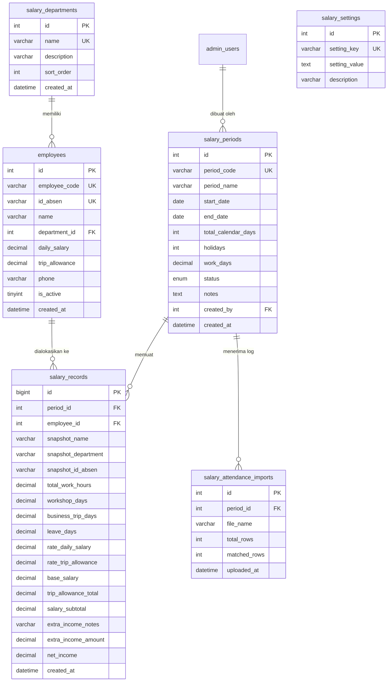

# Rencana & Spesifikasi Skema Database Internal: Modul Penggajian (Salary & Payroll)
**CV. ATEKA TEHNIK**  
*Dokumen Perancangan Database Sistem Internal Penggajian & Rekapitulasi Gaji*

---

## 1. Analisis Kebutuhan Sistem & Pemetaan Komponen

Berdasarkan analisis mendalam terhadap kode dan alur kerja pada 11 komponen frontend:
1. **`Employees.jsx` & `EmployeeModal.jsx`**: Manajemen master data karyawan aktif/non-aktif, pemetaan ID Mesin Absensi (`id_absen`), penetapan tarif harian bengkel (`daily_salary`) dan tarif dinas luar kota (`trip_allowance`).
2. **`DepartmentModal.jsx`**: Manajemen kategori divisi/departemen dengan dukungan operasi CRUD dan sinkronisasi berjenjang (*cascade*) ke data karyawan.
3. **`Periods.jsx` & `PeriodModal.jsx`**: Pembuatan siklus periode mingguan/bulanan, perhitungan otomatis hari kerja efektif (`work_days = range_days - holidays`), integrasi parser file Excel absensi (`XLSX`), serta status siklus (`Draft`, `Published`, `Paid`).
4. **`PeriodDetail.jsx` & `SalaryAdjustModal.jsx`**: Matriks perhitungan dinamis kehadiran (`workshop_days`, `business_trip_days`, `leave_days`), penyesuaian nominal tambahan (`extra_income_notes`, `extra_income_amount`), penguncian mode baca (*read-only*) saat status bukan *Draft*, serta sinkronisasi batch.
5. **`PayslipDocument.jsx`, `PayslipSingleModal.jsx`, `PayslipPrintBulk.jsx`**: Format cetak slip gaji perorangan dan cetak massal (A4 Portrait) lengkap dengan tanda tangan Direktur, tanggal dinamis Karanganyar, dan proteksi pemisah halaman (*page-break*).
6. **`SalaryReportModal.jsx`**: Laporan rekapitulasi gaji periode lengkap (A4 Landscape) dengan 4 kotak ringkasan metrik, tabel rekapitulasi, pengesahan Administrasi dan persetujuan Direktur.

---

## 2. Diagram Relasi Entitas (Entity-Relationship Diagram)



---

## 3. Spesifikasi Detail Tabel Database

### A. Tabel: `salary_departments`
Menyimpan daftar divisi/departemen yang dinamis dan terstruktur.

| # | Column | Type | Nullable | Key | Default | Extra | Keterangan |
|---|--------|------|----------|-----|---------|-------|------------|
| 1 | `id` | `int(11)` | NO | PRI | - | auto_increment | ID unik departemen |
| 2 | `name` | `varchar(100)` | NO | UNI | - | - | Nama departemen (uppercase, e.g. PRODUKSI) |
| 3 | `description` | `varchar(255)` | YES | - | NULL | - | Keterangan singkat fungsi departemen |
| 4 | `is_default` | `tinyint(1)` | NO | - | 0 | - | 1 jika termasuk departemen bawaan sistem |
| 5 | `sort_order` | `int(11)` | NO | - | 0 | - | Urutan penampilan di dropdown |
| 6 | `created_at` | `timestamp` | YES | - | current_timestamp() | - | Waktu data dibuat |
| 7 | `updated_at` | `timestamp` | YES | - | current_timestamp() | on update | Waktu terakhir diperbarui |

---

### B. Tabel: `employees`
Menyimpan master data karyawan aktif dan nonaktif CV. Ateka Tehnik.

| # | Column | Type | Nullable | Key | Default | Extra | Keterangan |
|---|--------|------|----------|-----|---------|-------|------------|
| 1 | `id` | `int(11)` | NO | PRI | - | auto_increment | Primary Key internal |
| 2 | `employee_code` | `varchar(30)` | NO | UNI | - | - | Kode unik karyawan (e.g. `ATK-001`) |
| 3 | `id_absen` | `varchar(50)` | YES | UNI | NULL | - | ID mesin fingerprint/absensi (e.g. `101`) |
| 4 | `name` | `varchar(255)` | NO | - | - | - | Nama lengkap karyawan |
| 5 | `department_id` | `int(11)` | YES | MUL | NULL | - | Relasi ke `salary_departments.id` |
| 6 | `department_name` | `varchar(100)` | NO | - | - | - | Cache nama departemen untuk performa tinggi |
| 7 | `daily_salary` | `decimal(15,2)` | NO | - | 150000.00 | - | Tarif harian bengkel standar |
| 8 | `trip_allowance` | `decimal(15,2)` | NO | - | 250000.00 | - | Tarif tunjangan harian perjalanan dinas |
| 9 | `phone` | `varchar(50)` | YES | - | NULL | - | Nomor kontak / WhatsApp karyawan |
| 10 | `is_active` | `tinyint(1)` | NO | - | 1 | - | 1 = Aktif, 0 = Non-aktif/Keluar |
| 11 | `created_at` | `timestamp` | YES | - | current_timestamp() | - | Waktu pendaftaran |
| 12 | `updated_at` | `timestamp` | YES | - | current_timestamp() | on update | Waktu pembaruan profil |

---

### C. Tabel: `salary_periods`
Menyimpan data periode siklus penggajian (mingguan/bulanan).

| # | Column | Type | Nullable | Key | Default | Extra | Keterangan |
|---|--------|------|----------|-----|---------|-------|------------|
| 1 | `id` | `int(11)` | NO | PRI | - | auto_increment | Primary Key periode |
| 2 | `period_code` | `varchar(50)` | NO | UNI | - | - | Kode unik periode (e.g. `PER-202610-W2`) |
| 3 | `period_name` | `varchar(150)` | NO | - | - | - | Judul periode (e.g. `OKTOBER 2026 - MINGGU KE 2`) |
| 4 | `start_date` | `date` | NO | - | - | - | Tanggal awal periode |
| 5 | `end_date` | `date` | NO | - | - | - | Tanggal akhir periode |
| 6 | `total_calendar_days`| `int(11)` | NO | - | 6 | - | Total hari kalender rentang tanggal |
| 7 | `holidays` | `int(11)` | NO | - | 0 | - | Jumlah hari libur yang dikurangkan |
| 8 | `work_days` | `decimal(4,2)` | NO | - | 6.00 | - | Hari kerja standar efektif (`calendar - holidays`) |
| 9 | `status` | `enum('Draft','Published','Paid')` | NO | - | 'Draft' | - | Status siklus penggajian |
| 10 | `notes` | `text` | YES | - | NULL | - | Catatan operasional periode |
| 11 | `created_by` | `int(11)` | YES | MUL | NULL | - | User pembuat (Relasi ke `admin_users.id`) |
| 12 | `published_at` | `datetime` | YES | - | NULL | - | Waktu dipublikasikan |
| 13 | `paid_at` | `datetime` | YES | - | NULL | - | Waktu pembayaran diselesaikan |
| 14 | `created_at` | `timestamp` | YES | - | current_timestamp() | - | Waktu dibuat |
| 15 | `updated_at` | `timestamp` | YES | - | current_timestamp() | on update | Waktu terakhir diedit |

---

### D. Tabel: `salary_records`
Menyimpan rekaman kalkulasi gaji karyawan per periode (Attendance & Payroll matrix).

| # | Column | Type | Nullable | Key | Default | Extra | Keterangan |
|---|--------|------|----------|-----|---------|-------|------------|
| 1 | `id` | `bigint(20)` | NO | PRI | - | auto_increment | Primary Key transaksi |
| 2 | `record_code` | `varchar(100)` | NO | UNI | - | - | Kode baris (`REC-PER...-EMP...`) |
| 3 | `period_id` | `int(11)` | NO | MUL | - | - | Relasi ke `salary_periods.id` |
| 4 | `employee_id` | `int(11)` | NO | MUL | - | - | Relasi ke `employees.id` |
| 5 | `snapshot_name` | `varchar(255)` | NO | - | - | - | Snapshot nama saat periode dihitung |
| 6 | `snapshot_department` | `varchar(100)` | NO | - | - | - | Snapshot divisi saat periode dihitung |
| 7 | `snapshot_id_absen` | `varchar(50)` | YES | - | NULL | - | Snapshot ID Absen |
| 8 | `total_work_hours` | `decimal(6,2)` | NO | - | 0.00 | - | Total jam kerja riil (hasil import Excel absensi / fingerprint, e.g. 44.00, 48.00 jam) |
| 9 | `workshop_days` | `decimal(4,2)` | NO | - | 0.00 | - | Hadir bengkel (hari, konversi: `total_work_hours / 8`, e.g. 5.50) |
| 10 | `business_trip_days` | `decimal(4,2)` | NO | - | 0.00 | - | Perjalanan dinas luar kota (hari) |
| 11 | `leave_days` | `decimal(4,2)` | NO | - | 0.00 | - | Cuti/izin otomatis: `work_days - (trip + workshop)` |
| 12 | `rate_daily_salary` | `decimal(15,2)`| NO | - | 0.00 | - | Snapshot tarif harian bengkel (Rp) |
| 13 | `rate_trip_allowance`| `decimal(15,2)`| NO | - | 0.00 | - | Snapshot tarif tunjangan luar kota (Rp) |
| 14 | `base_salary` | `decimal(15,2)`| NO | - | 0.00 | - | Total gaji pokok (`workshop_days * rate`) |
| 15 | `trip_allowance_total`| `decimal(15,2)`| NO | - | 0.00 | - | Total tunjangan perjalanan (`trip * rate`) |
| 16 | `salary_subtotal` | `decimal(15,2)`| NO | - | 0.00 | - | Subtotal gaji (`base + trip_total`) |
| 17 | `extra_income_notes` | `varchar(255)` | YES | - | NULL | - | Keterangan tambahan (e.g. Lembur) |
| 18 | `extra_income_amount`| `decimal(15,2)`| NO | - | 0.00 | - | Nominal tambahan (Rp) |
| 19 | `net_income` | `decimal(15,2)`| NO | - | 0.00 | - | Penghasilan bersih akhir (`subtotal + extra`) |
| 20 | `created_at` | `timestamp` | YES | - | current_timestamp() | - | Waktu rekaman dibuat |
| 21 | `updated_at` | `timestamp` | YES | - | current_timestamp() | on update | Waktu kalkulasi diperbarui |

*Index Unik Tambahan:*  
`UNIQUE KEY uk_period_employee (period_id, employee_id)` — Mencegah duplikasi karyawan dalam 1 periode yang sama.

---

### E. Tabel: `salary_attendance_imports`
Mencatat riwayat unggahan berkas Excel absensi mesin fingerprint.

| # | Column | Type | Nullable | Key | Default | Extra | Keterangan |
|---|--------|------|----------|-----|---------|-------|------------|
| 1 | `id` | `int(11)` | NO | PRI | - | auto_increment | ID riwayat upload |
| 2 | `period_id` | `int(11)` | NO | MUL | - | - | Relasi ke `salary_periods.id` |
| 3 | `file_name` | `varchar(255)` | NO | - | - | - | Nama file asli (e.g. `Absensi_Okt_W2.xlsx`) |
| 4 | `total_rows` | `int(11)` | NO | - | 0 | - | Total baris terbaca dalam file |
| 5 | `matched_rows` | `int(11)` | NO | - | 0 | - | Baris yang cocok dengan karyawan aktif |
| 6 | `unmatched_rows` | `int(11)` | NO | - | 0 | - | Baris yang tidak cocok (nama/id tidak ada) |
| 7 | `uploaded_by` | `int(11)` | YES | - | NULL | - | User pengunggah |
| 8 | `created_at` | `timestamp` | YES | - | current_timestamp() | - | Waktu impor |

---

### F. Tabel: `salary_settings`
Menyimpan konfigurasi pengesahan dokumen, tanda tangan direktur, kota asal, dan footer slip gaji.

| # | Column | Type | Nullable | Key | Default | Extra | Keterangan |
|---|--------|------|----------|-----|---------|-------|------------|
| 1 | `id` | `int(11)` | NO | PRI | - | auto_increment | Primary Key |
| 2 | `setting_key` | `varchar(100)` | NO | UNI | - | - | Kunci konfigurasi |
| 3 | `setting_value`| `text` | YES | - | NULL | - | Nilai konfigurasi |
| 4 | `description` | `varchar(255)` | YES | - | NULL | - | Keterangan penggunaan parameter |
| 5 | `updated_at` | `timestamp` | YES | - | current_timestamp() | on update | Waktu update |

*Contoh data `salary_settings`:*
- `city_name` = `'Karanganyar'`
- `company_name` = `'CV. ATEKA TEHNIK'`
- `director_title` = `'( DIREKTUR )'`
- `director_signature_url` = `'https://atekatehnik.com/wp/uploads/asset_6acd5d6b506ee2.49528031.png'`
- `admin_title` = `'( ADMINISTRASI )'`
- `payslip_notice` = `'Apabila terdapat kesalahan input gaji mohon di laporkan secara terang terangan ke pihak CV Ateka Tehnik!!!!!'`

---

## 4. Skrip SQL DDL Lengkap (MariaDB / MySQL)

Skrip SQL berikut dapat langsung dieksekusi di database server:

```sql
-- ============================================================================
-- SKRIP TABEL PENGGAJIAN ATEKA TEHNIK (INTERNAL PAYROLL SYSTEM)
-- Database Target: u444914729_ateka / ateka_local
-- ============================================================================

SET FOREIGN_KEY_CHECKS = 0;

-- 1. TABEL DEPARTEMEN / DIVISI
CREATE TABLE IF NOT EXISTS `salary_departments` (
  `id` INT(11) NOT NULL AUTO_INCREMENT,
  `name` VARCHAR(100) NOT NULL,
  `description` VARCHAR(255) DEFAULT NULL,
  `is_default` TINYINT(1) NOT NULL DEFAULT 0,
  `sort_order` INT(11) NOT NULL DEFAULT 0,
  `created_at` TIMESTAMP NULL DEFAULT CURRENT_TIMESTAMP(),
  `updated_at` TIMESTAMP NULL DEFAULT CURRENT_TIMESTAMP() ON UPDATE CURRENT_TIMESTAMP(),
  PRIMARY KEY (`id`),
  UNIQUE KEY `uk_department_name` (`name`)
) ENGINE=InnoDB DEFAULT CHARSET=utf8mb4 COLLATE=utf8mb4_unicode_ci;

-- 2. TABEL KARYAWAN
CREATE TABLE IF NOT EXISTS `employees` (
  `id` INT(11) NOT NULL AUTO_INCREMENT,
  `employee_code` VARCHAR(30) NOT NULL,
  `id_absen` VARCHAR(50) DEFAULT NULL,
  `name` VARCHAR(255) NOT NULL,
  `department_id` INT(11) DEFAULT NULL,
  `department_name` VARCHAR(100) NOT NULL,
  `daily_salary` DECIMAL(15,2) NOT NULL DEFAULT 150000.00,
  `trip_allowance` DECIMAL(15,2) NOT NULL DEFAULT 250000.00,
  `phone` VARCHAR(50) DEFAULT NULL,
  `is_active` TINYINT(1) NOT NULL DEFAULT 1,
  `created_at` TIMESTAMP NULL DEFAULT CURRENT_TIMESTAMP(),
  `updated_at` TIMESTAMP NULL DEFAULT CURRENT_TIMESTAMP() ON UPDATE CURRENT_TIMESTAMP(),
  PRIMARY KEY (`id`),
  UNIQUE KEY `uk_employee_code` (`employee_code`),
  UNIQUE KEY `uk_employee_id_absen` (`id_absen`),
  KEY `idx_emp_department` (`department_id`),
  KEY `idx_emp_active` (`is_active`),
  CONSTRAINT `fk_emp_department` FOREIGN KEY (`department_id`) 
    REFERENCES `salary_departments` (`id`) ON DELETE SET NULL ON UPDATE CASCADE
) ENGINE=InnoDB DEFAULT CHARSET=utf8mb4 COLLATE=utf8mb4_unicode_ci;

-- 3. TABEL PERIODE PENGGAJIAN
CREATE TABLE IF NOT EXISTS `salary_periods` (
  `id` INT(11) NOT NULL AUTO_INCREMENT,
  `period_code` VARCHAR(50) NOT NULL,
  `period_name` VARCHAR(150) NOT NULL,
  `start_date` DATE NOT NULL,
  `end_date` DATE NOT NULL,
  `total_calendar_days` INT(11) NOT NULL DEFAULT 6,
  `holidays` INT(11) NOT NULL DEFAULT 0,
  `work_days` DECIMAL(4,2) NOT NULL DEFAULT 6.00,
  `status` ENUM('Draft','Published','Paid') NOT NULL DEFAULT 'Draft',
  `notes` TEXT DEFAULT NULL,
  `created_by` INT(11) DEFAULT NULL,
  `published_at` DATETIME DEFAULT NULL,
  `paid_at` DATETIME DEFAULT NULL,
  `created_at` TIMESTAMP NULL DEFAULT CURRENT_TIMESTAMP(),
  `updated_at` TIMESTAMP NULL DEFAULT CURRENT_TIMESTAMP() ON UPDATE CURRENT_TIMESTAMP(),
  PRIMARY KEY (`id`),
  UNIQUE KEY `uk_period_code` (`period_code`),
  KEY `idx_period_status` (`status`),
  KEY `idx_period_dates` (`start_date`, `end_date`),
  KEY `idx_period_created_by` (`created_by`)
) ENGINE=InnoDB DEFAULT CHARSET=utf8mb4 COLLATE=utf8mb4_unicode_ci;

-- 4. TABEL REKAMAN PENGGAJIAN PER KARYAWAN (TRANSAKSI UTAMA)
CREATE TABLE IF NOT EXISTS `salary_records` (
  `id` BIGINT(20) NOT NULL AUTO_INCREMENT,
  `record_code` VARCHAR(100) NOT NULL,
  `period_id` INT(11) NOT NULL,
  `employee_id` INT(11) NOT NULL,
  `snapshot_name` VARCHAR(255) NOT NULL,
  `snapshot_department` VARCHAR(100) NOT NULL,
  `snapshot_id_absen` VARCHAR(50) DEFAULT NULL,
  `total_work_hours` DECIMAL(6,2) NOT NULL DEFAULT 0.00,
  `workshop_days` DECIMAL(4,2) NOT NULL DEFAULT 0.00,
  `business_trip_days` DECIMAL(4,2) NOT NULL DEFAULT 0.00,
  `leave_days` DECIMAL(4,2) NOT NULL DEFAULT 0.00,
  `rate_daily_salary` DECIMAL(15,2) NOT NULL DEFAULT 0.00,
  `rate_trip_allowance` DECIMAL(15,2) NOT NULL DEFAULT 0.00,
  `base_salary` DECIMAL(15,2) NOT NULL DEFAULT 0.00,
  `trip_allowance_total` DECIMAL(15,2) NOT NULL DEFAULT 0.00,
  `salary_subtotal` DECIMAL(15,2) NOT NULL DEFAULT 0.00,
  `extra_income_notes` VARCHAR(255) DEFAULT NULL,
  `extra_income_amount` DECIMAL(15,2) NOT NULL DEFAULT 0.00,
  `net_income` DECIMAL(15,2) NOT NULL DEFAULT 0.00,
  `created_at` TIMESTAMP NULL DEFAULT CURRENT_TIMESTAMP(),
  `updated_at` TIMESTAMP NULL DEFAULT CURRENT_TIMESTAMP() ON UPDATE CURRENT_TIMESTAMP(),
  PRIMARY KEY (`id`),
  UNIQUE KEY `uk_record_code` (`record_code`),
  UNIQUE KEY `uk_period_employee` (`period_id`, `employee_id`),
  KEY `idx_record_period` (`period_id`),
  KEY `idx_record_employee` (`employee_id`),
  CONSTRAINT `fk_rec_period` FOREIGN KEY (`period_id`) 
    REFERENCES `salary_periods` (`id`) ON DELETE CASCADE ON UPDATE CASCADE,
  CONSTRAINT `fk_rec_employee` FOREIGN KEY (`employee_id`) 
    REFERENCES `employees` (`id`) ON DELETE RESTRICT ON UPDATE CASCADE
) ENGINE=InnoDB DEFAULT CHARSET=utf8mb4 COLLATE=utf8mb4_unicode_ci;

-- 5. TABEL LOG IMPOR EXCEL ABSENSI
CREATE TABLE IF NOT EXISTS `salary_attendance_imports` (
  `id` INT(11) NOT NULL AUTO_INCREMENT,
  `period_id` INT(11) NOT NULL,
  `file_name` VARCHAR(255) NOT NULL,
  `total_rows` INT(11) NOT NULL DEFAULT 0,
  `matched_rows` INT(11) NOT NULL DEFAULT 0,
  `unmatched_rows` INT(11) NOT NULL DEFAULT 0,
  `uploaded_by` INT(11) DEFAULT NULL,
  `created_at` TIMESTAMP NULL DEFAULT CURRENT_TIMESTAMP(),
  PRIMARY KEY (`id`),
  KEY `idx_import_period` (`period_id`),
  CONSTRAINT `fk_import_period` FOREIGN KEY (`period_id`) 
    REFERENCES `salary_periods` (`id`) ON DELETE CASCADE ON UPDATE CASCADE
) ENGINE=InnoDB DEFAULT CHARSET=utf8mb4 COLLATE=utf8mb4_unicode_ci;

-- 6. TABEL PENGATURAN UMUM PENGGAJIAN
CREATE TABLE IF NOT EXISTS `salary_settings` (
  `id` INT(11) NOT NULL AUTO_INCREMENT,
  `setting_key` VARCHAR(100) NOT NULL,
  `setting_value` TEXT DEFAULT NULL,
  `description` VARCHAR(255) DEFAULT NULL,
  `updated_at` TIMESTAMP NULL DEFAULT CURRENT_TIMESTAMP() ON UPDATE CURRENT_TIMESTAMP(),
  PRIMARY KEY (`id`),
  UNIQUE KEY `uk_salary_setting_key` (`setting_key`)
) ENGINE=InnoDB DEFAULT CHARSET=utf8mb4 COLLATE=utf8mb4_unicode_ci;

SET FOREIGN_KEY_CHECKS = 1;
```

---

## 5. Seed Data Awal (Migrasi dari Default Mock Data)

```sql
-- 1. Data Master Departemen (8 Divisi)
INSERT INTO `salary_departments` (`id`, `name`, `description`, `is_default`, `sort_order`) VALUES
(1, 'KEUANGAN', 'Divisi Keuangan & Pembukuan', 1, 1),
(2, 'DIREKTUR', 'Pimpinan & Direksi Perusahaan', 1, 2),
(3, 'ADMIN', 'Divisi Administrasi & Operasional Kantor', 1, 3),
(4, 'PRODUKSI', 'Divisi Fabrikasi dan Produksi Mesin Rice Mill', 1, 4),
(5, 'HELPER', 'Divisi Helper & Pembantu Operasional Lapangan', 1, 5),
(6, 'CHEF', 'Divisi Dapur & Konsumsi Karyawan', 1, 6),
(7, 'PENJUALAN', 'Divisi Pemasaran & Penjualan Unit Mesin', 1, 7),
(8, 'PKL', 'Peserta Praktik Kerja Lapangan (PKL)', 1, 8)
ON DUPLICATE KEY UPDATE 
  `name` = VALUES(`name`),
  `description` = VALUES(`description`),
  `sort_order` = VALUES(`sort_order`);

-- 2. Data Master Karyawan (24 Karyawan - Kode ATK-001 s/d ATK-024)
INSERT INTO `employees` (`id`, `employee_code`, `id_absen`, `name`, `department_id`, `department_name`, `daily_salary`, `trip_allowance`, `is_active`) VALUES
(1, 'ATK-001', '1', 'BARRONSAVE', 1, 'KEUANGAN', 100000.00, 0.00, 1),
(2, 'ATK-002', '2', 'WARSITO', 2, 'DIREKTUR', 0.00, 0.00, 1),
(3, 'ATK-003', '3', 'INSANI', 3, 'ADMIN', 100000.00, 0.00, 1),
(4, 'ATK-004', '4', 'WARSITO', 4, 'PRODUKSI', 165000.00, 0.00, 1),
(5, 'ATK-005', '5', 'MULYOTO', 4, 'PRODUKSI', 175000.00, 300000.00, 1),
(6, 'ATK-006', '6', 'SAMSUNRUDIN', 4, 'PRODUKSI', 155000.00, 250000.00, 1),
(7, 'ATK-007', '7', 'DIKI PURWOKO', 4, 'PRODUKSI', 155000.00, 250000.00, 1),
(8, 'ATK-008', '8', 'WINARNO', 4, 'PRODUKSI', 155000.00, 250000.00, 1),
(9, 'ATK-009', '9', 'ERWIN SASONGKO', 4, 'PRODUKSI', 150000.00, 250000.00, 1),
(10, 'ATK-010', '10', 'REBO MURYANTO', 5, 'HELPER', 100000.00, 0.00, 1),
(11, 'ATK-011', '11', 'KRISTIANTO', 4, 'PRODUKSI', 130000.00, 225000.00, 1),
(12, 'ATK-012', '12', 'SAMIDI', 4, 'PRODUKSI', 110000.00, 0.00, 1),
(13, 'ATK-013', '13', 'AMIR ROSYID', 4, 'PRODUKSI', 110000.00, 200000.00, 1),
(14, 'ATK-014', '14', 'ANJAS', 4, 'PRODUKSI', 100000.00, 0.00, 1),
(15, 'ATK-015', '15', 'RISKI FAJAR S', 4, 'PRODUKSI', 100000.00, 200000.00, 1),
(16, 'ATK-016', '16', 'SURADI', 4, 'PRODUKSI', 130000.00, 225000.00, 1),
(17, 'ATK-017', '17', 'SOLIKHUL ANAM', 5, 'HELPER', 150000.00, 300000.00, 1),
(18, 'ATK-018', '18', 'SUKISMAN', 4, 'PRODUKSI', 130000.00, 0.00, 1),
(19, 'ATK-019', '19', 'DANI  S', 4, 'PRODUKSI', 100000.00, 200000.00, 1),
(20, 'ATK-020', '20', 'NAFI N H', 4, 'PRODUKSI', 150000.00, 300000.00, 1),
(21, 'ATK-021', '21', 'RISKI KINTIL', 4, 'PRODUKSI', 80000.00, 150000.00, 1),
(22, 'ATK-022', '22', 'LESTARI', 6, 'CHEF', 41666.00, 0.00, 1),
(23, 'ATK-023', '23', 'KUNTUM INDAH', 7, 'PENJUALAN', 100000.00, 0.00, 1),
(24, 'ATK-024', '24', 'SHENDI', 4, 'PRODUKSI', 80000.00, 0.00, 1)
ON DUPLICATE KEY UPDATE 
  `name` = VALUES(`name`),
  `department_id` = VALUES(`department_id`),
  `department_name` = VALUES(`department_name`),
  `daily_salary` = VALUES(`daily_salary`),
  `trip_allowance` = VALUES(`trip_allowance`),
  `is_active` = VALUES(`is_active`);

-- 3. Data Default Pengaturan Sistem Penggajian
INSERT INTO `salary_settings` (`setting_key`, `setting_value`, `description`) VALUES
('city_name', 'Karanganyar', 'Kota penandatanganan dokumen dan slip gaji'),
('director_name', 'WARSITO', 'Nama Direktur Utama CV. Ateka Tehnik'),
('director_title', '( DIREKTUR )', 'Label jabatan penandatangan direktur'),
('director_signature_url', 'https://atekatehnik.com/wp/uploads/asset_6acd5d6b506ee2.49528031.png', 'URL aset gambar tanda tangan direktur'),
('admin_title', '( ADMINISTRASI )', 'Label jabatan pembuat laporan rekapitulasi gaji'),
('payslip_notice', 'Apabila terdapat kesalahan input gaji mohon di laporkan secara terang terangan ke pihak CV Ateka Tehnik!!!!!', 'Catatan kaki peringatan pada slip gaji')
ON DUPLICATE KEY UPDATE `setting_value` = VALUES(`setting_value`);

-- 4. Data Contoh Periode Awal
INSERT INTO `salary_periods` (`id`, `period_code`, `period_name`, `start_date`, `end_date`, `total_calendar_days`, `holidays`, `work_days`, `status`, `notes`) VALUES
(1, 'PER-202610-W2', 'OKTOBER 2026 - MINGGU KE 2', '2026-10-05', '2026-10-10', 6, 0, 6.00, 'Draft', 'Periode penggajian reguler minggu ke-2 Oktober 2026')
ON DUPLICATE KEY UPDATE `period_name` = VALUES(`period_name`);

-- 5. Data Contoh Rekaman Penggajian (Menyimpan total_work_hours & hasil konversi workshop_days)
INSERT INTO `salary_records` (`record_code`, `period_id`, `employee_id`, `snapshot_name`, `snapshot_department`, `snapshot_id_absen`, `total_work_hours`, `workshop_days`, `business_trip_days`, `leave_days`, `rate_daily_salary`, `rate_trip_allowance`, `base_salary`, `trip_allowance_total`, `salary_subtotal`, `extra_income_notes`, `extra_income_amount`, `net_income`) VALUES
('REC-PER-202610-W2-ATK-009', 1, 9, 'ERWIN SASONGKO', 'PRODUKSI', '9', 44.00, 5.50, 0.00, 0.50, 150000.00, 250000.00, 825000.00, 0.00, 825000.00, 'EVI', 50000.00, 875000.00),
('REC-PER-202610-W2-ATK-005', 1, 5, 'MULYOTO', 'PRODUKSI', '5', 32.00, 4.00, 2.00, 0.00, 175000.00, 300000.00, 700000.00, 600000.00, 1300000.00, 'Lembur Perakitan', 75000.00, 1375000.00),
('REC-PER-202610-W2-ATK-001', 1, 1, 'BARRONSAVE', 'KEUANGAN', '1', 48.00, 6.00, 0.00, 0.00, 100000.00, 0.00, 600000.00, 0.00, 600000.00, '', 0.00, 600000.00)
ON DUPLICATE KEY UPDATE `net_income` = VALUES(`net_income`);
```

---

## 6. Rencana Implementasi API Endpoint Backend (`public/api/salary/`)

Untuk menggantikan penyimpanan `localStorage` ke MySQL, berikut struktur endpoint REST API PHP yang disiapkan di `public/api/salary/`:

```
public/api/salary/
├── departments.php        # GET: list, POST: tambah, PUT: edit (cascade), DELETE: hapus
├── employees.php          # GET: list/filter, POST: simpan/tambah, PUT: edit, DELETE: hapus
├── periods.php            # GET: list/detail, POST: buat periode baru, PUT: update, DELETE: hapus
├── period_records.php     # GET: records per periode, PUT: simpan baris/adjust, POST: batch sync
├── attendance_upload.php  # POST: unggah & ekstrak file Excel absensi ke periode aktif
└── settings.php           # GET & PUT: informasi perusahaan, kota Karanganyar, URL tanda tangan
```

### Pemetaan Fungsi Frontend ke Backend:
| Fungsi Frontend (`salaryStorage.js`) | Metode HTTP | Endpoint Backend | Fungsi Database |
|--------------------------------------|-------------|------------------|-----------------|
| `getDepartments()` | `GET` | `/api/salary/departments.php` | `SELECT * FROM salary_departments ORDER BY sort_order, name` |
| `addDepartment(name)` | `POST` | `/api/salary/departments.php` | `INSERT INTO salary_departments` |
| `updateDepartment(old, new)` | `PUT` | `/api/salary/departments.php` | `UPDATE salary_departments` & cascade update |
| `deleteDepartment(name)` | `DELETE` | `/api/salary/departments.php?name=...` | `DELETE FROM salary_departments` |
| `getEmployees()` | `GET` | `/api/salary/employees.php` | `SELECT * FROM employees ORDER BY id ASC` |
| `saveEmployee(data)` | `POST / PUT` | `/api/salary/employees.php` | `INSERT / UPDATE employees` |
| `deleteEmployee(id)` | `DELETE` | `/api/salary/employees.php?id=...` | `UPDATE employees SET is_active=0` (Soft delete) |
| `getPeriods()` | `GET` | `/api/salary/periods.php` | `SELECT p.*, COUNT(r.id) AS total_employees, SUM(r.net_income) AS total_net FROM salary_periods p LEFT JOIN salary_records r ON p.id=r.period_id GROUP BY p.id ORDER BY p.start_date DESC` |
| `getPeriodById(id)` | `GET` | `/api/salary/periods.php?id=...` | `SELECT * FROM salary_periods WHERE id = ?` |
| `savePeriod(data)` | `POST / PUT` | `/api/salary/periods.php` | `INSERT/UPDATE salary_periods` & otomatis `initPeriodRecordsFromEmployees` |
| `deletePeriod(id)` | `DELETE` | `/api/salary/periods.php?id=...` | `DELETE FROM salary_periods WHERE id = ?` (Cascade records) |
| `getPeriodRecords(periodId)` | `GET` | `/api/salary/period_records.php?period_id=...` | `SELECT * FROM salary_records WHERE period_id = ? ORDER BY id ASC` |
| `saveRecord(record)` | `PUT` | `/api/salary/period_records.php` | `UPDATE salary_records` (Kalkulasi `calculateSalaryRow`) |
| `batchSaveRecords(periodId, rows)` | `POST` | `/api/salary/period_records.php?action=batch` | Batch Update transaksi MySQL dengan `PDO::beginTransaction()` |
| `initPeriodRecordsFromEmployees(pId)`| `POST` | `/api/salary/period_records.php?action=sync` | Generate `salary_records` dari seluruh `employees WHERE is_active=1` |
| `applyAttendanceToPeriod(pId, rows)` | `POST` | `/api/salary/attendance_upload.php` | Mencocokkan `id_absen` / `name` ke `salary_records` & simpan log ke `salary_attendance_imports` |

---

## 7. Validasi Integritas Data & Business Rules

1. **Integritas Nilai Kalkulasi**:
   - `workshop_days = ROUND(total_work_hours / 8, 2)` (konversi standar jam kerja mesin absensi: 8 jam = 1 hari kerja bengkel)
   - `base_salary = ROUND(workshop_days * rate_daily_salary)`
   - `trip_allowance_total = ROUND(business_trip_days * rate_trip_allowance)`
   - `salary_subtotal = base_salary + trip_allowance_total`
   - `net_income = salary_subtotal + extra_income_amount`
   - `leave_days = MAX(0, work_days - (workshop_days + business_trip_days))`

2. **Aturan Penguncian Status (*Locking Mechanism*)**:
   - Jika `salary_periods.status != 'Draft'`, API backend akan menolak segala manipulasi data (`INSERT`, `UPDATE`, `DELETE`) pada `salary_records` terkait, sehingga integritas data slip gaji yang sudah dicetak/dibayar terjamin 100% konsisten.

3. **Snapshot Immutability**:
   - Penyimpanan `snapshot_name`, `snapshot_department`, dan snapshot tarif pada `salary_records` menjamin laporan masa lalu tidak akan terpengaruh jika ada perubahan nama/tarif pada master `employees`.
